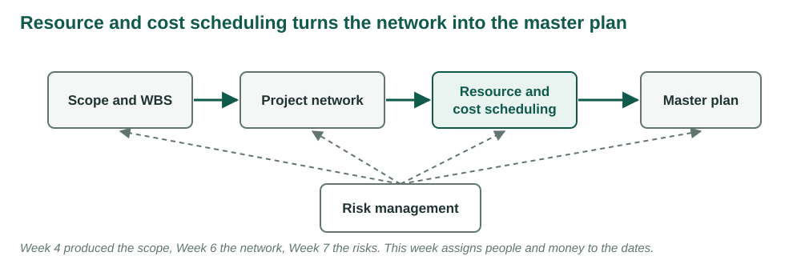
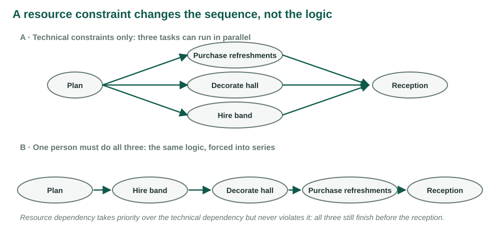

## {.center}

> Project network times are not a schedule until resources have been assigned. Cost estimates are not a budget until they have been time-phased.

*Clifford F. Gray, quoted in Larson & Gray, Ch. 8 [1]. Figures redrawn from the chapter. The conference's coordinators, costs and schedules are original to this course.*

## What this week adds to the plan

Weeks 4 to 7 produced a scope, a network, estimates and a risk register.

. . .

All of them assumed one thing: whoever an activity needs will be free on the day it starts.

. . .

This week asks what happens to the dates when that is false, and then lays the budget out over the dates that survive.

## Learning objectives

| | |
|---|---|
| **LO 8-1** | Time-constrained or resource-constrained |
| **LO 8-2** | Kinds of resource constraint |
| **LO 8-3** | Smooth demand on a time-constrained project |
| **LO 8-4** | Level a resource-constrained project |
| **LO 8-5** | How the software does it |

## Learning objectives

| | |
|---|---|
| **LO 8-6** | When not to split an activity |
| **LO 8-7** | Assigning people to tasks |
| **LO 8-8** | Multiproject scheduling problems |
| **LO 8-9** | Why the budget must be time-phased |
| **LO 8-10** | Build the time-phased baseline |

# LO 8-1 · Time-constrained or resource-constrained

::: {.aside}
Following Larson & Gray, Ch. 8, Sections 8.1 to 8.3, Figures 8.1 and 8.2
:::

## The last planning step

<figure>

</figure>

## Five questions the network cannot answer

- Will the people and equipment be enough, and free when needed?
- Will outside contractors be required?
- Are there resource dependencies the network does not show? A new critical path?
- How much freedom is there to move resources?
- Is the deadline still realistic?

## Two ways the network is wrong about resources

**Demand is uneven.** Peaks and valleys in who is needed each day. Remedy: **smoothing**, delay noncritical work inside its slack, finish date unchanged.

. . .

**Demand exceeds supply.** The peak needs people who do not exist. Remedy: **resource-constrained scheduling**, delay work until the resource is free, accept a later finish, make it as small as possible.

## A resource constraint changes the sequence, not the logic

<figure>

</figure>

## Why not put resources in the network from the start?

Availability is not known until a first schedule exists.

. . .

And without a resource-neutral schedule, nobody can see what the resources are costing.

. . .

The network is the baseline the price of a constraint is measured against.

## The classification test

*If the critical path slips, will resources be added to get back on schedule?*

. . .

**Yes:** time-constrained. The date is fixed; use resources efficiently.

**No:** resource-constrained. The limit is fixed; minimise the delay.

. . .

The Week 4 priority matrix already holds the answer.

## Everyone is at 140% in November

The conference plan goes into scheduling software. The coordinators are assigned.

The resource graph turns red: three coordinators needed at 167% for three days.

A colleague's software release shows one analyst at 140% for all of November.

. . .

Both plans passed their critical-path review. What did that review assume?

# LO 8-2 · Kinds of resource constraint

::: {.aside}
Following Larson & Gray, Ch. 8, Section 8.2
:::

## People, materials, equipment

| Resource | Constrains through | Conference |
|---|---|---|
| People | Skills are not interchangeable; one person, one place | Three coordinators across B to I |
| Materials | Delivery windows and lead times | Five printer days after the program is published |
| Equipment | Type, size, quantity; shared with other projects | Two livestream kits for the whole university |

## The pool is smaller than it looks

The question is not how many livestream kits exist.

. . .

It is how many are free on the keynote's day.

. . .

A common resource pool, checked across every project, is the only way to know.

# LO 8-3 · Smoothing a time-constrained project

::: {.aside}
Following Larson & Gray, Ch. 8, Section 8.4, Figure 8.3
:::

## The conference with coordinators and costs

| ID | Activity | Pred. | Days | Coord. | Cost |
|:-:|---|:-:|--:|--:|--:|
| A | Approve event brief | — | 2 | 1 | $2,000 |
| B | Contract venue | A | 5 | 2 | 30,000 |
| C | Draft program | A | 6 | 1 | 6,000 |
| D | Configure registration | B | 4 | 1 | 8,000 |
| E | Confirm speakers | C | 8 | 2 | 12,000 |

## The conference with coordinators and costs

| ID | Activity | Pred. | Days | Coord. | Cost |
|:-:|---|:-:|--:|--:|--:|
| F | Recruit exhibitors | C | 5 | 2 | 2,500 |
| G | Publish program | D, E | 3 | 1 | 3,000 |
| H | Prepare on-site materials | F, G | 4 | 2 | 4,000 |
| I | Complete rehearsal | H | 2 | 2 | 2,500 |
| | **Total** | | | | **$70,000** |

Week 6 network, Week 7 budget. Costs spread evenly over each activity's days.

## Coordinators needed each day

<figure>

</figure>

## Smoothing with four coordinators

Peak of five on days 9 to 11: D, E and F together.

. . .

F has six days of slack. Delay it until D finishes on day 11.

. . .

Load falls to three on days 9 to 11, rises to four on days 12 to 16. F finishes day 16, inside its late finish of 19. Project still 25.

## The three goals of smoothing

1. A lower peak.
2. Fewer resources over the life of the project.
3. Smaller swings from day to day.

. . .

The chapter's botanical garden cuts a backhoe peak from four to three the same way [1].

## Smoothing spends slack

F had six days of slack. Now it has three.

. . .

A slip in E that was absorbed before now delays the finish.

. . .

Level toward a flat profile and every activity becomes critical.

# LO 8-4 · Levelling a resource-constrained project

::: {.aside}
Following Larson & Gray, Ch. 8, Section 8.4, Figures 8.4 and 8.5
:::

## Three coordinators, no fourth

Days 9 to 11 need five. Something has to give.

. . .

Delay activities so that the limit holds every day, the logic is never broken, and the finish moves as little as possible.

. . .

Two learning assumptions: no splitting once started; the resource level does not change.

## Why nobody solves it exactly

The problem is combinatorial. A small network has thousands of feasible schedules.

. . .

Exact methods exist for small networks [3]. Real projects use **heuristics**: rules that build a good schedule fast without promising the best.

## The parallel method

Step through the schedule one period at a time.

. . .

In each period, list the activities whose predecessors are finished.

. . .

Rank them by the priority rule. Start as many as the limit allows. Delay the rest and recheck next period.

## The priority rule

1. **Minimum slack**, recomputed as LF − now − duration
2. then **smallest duration**
3. then **lowest activity ID**

. . .

An activity that has waited past its late start has negative slack and goes to the front.

## The chapter's example: seven activities, three programmers

| ID | Prog. | Dur. | ES | LF | Slack | Pred. |
|:-:|--:|--:|--:|--:|--:|:-:|
| 1 | 2 | 2 | 0 | 2 | 0 | — |
| 2 | 2 | 6 | 2 | 10 | 2 | 1 |
| 3 | 2 | 4 | 2 | 6 | 0 | 1 |
| 4 | 1 | 2 | 2 | 10 | 6 | 1 |
| 5 | 1 | 2 | 6 | 10 | 2 | 3 |
| 6 | 1 | 4 | 6 | 10 | 0 | 3 |
| 7 | 1 | 2 | 10 | 12 | 0 | 2, 5, 6 |

Values from Figure 8.4 [1]. Early-start load: 2, 2, 5, 5, 4, 4, 4, 4, 1, 1, 1, 1.

## Six decisions

| Period | Eligible, in priority order | Decision | Used |
|:-:|---|---|:-:|
| 0 | 1 | start 1 | 2 |
| 2 | 3 (0), 2 (2), 4 (6) | start 3; delay 2; start 4 | 3 |
| 4 | 2 (0) | 3 still running; delay 2 | 2 |
| 6 | 2 (−2), 6 (0), 5 (2) | start 2, start 6; delay 5 | 3 |
| 10 | 5 (−2) | start 5 | 3 |
| 12 | 7 | start 7 | 1 |

Finish 14 instead of 12. Two periods is the price of three programmers rather than five.

## The conference with three coordinators

| Day | Eligible (slack, need) | Decision | Used |
|:-:|---|---|:-:|
| 8 | E (0, 2), F (6, 2) | D running; start E; delay F | 3 |
| 11 | F (3, 2) | E holds 2; delay F | 2 |
| 16 | F (−2), G (0) | start F and G | 3 |
| 21 | H | start H | 2 |
| 25 | I | start I | 2 |

. . .

Finish day 27. F, comfortably noncritical in the network, set the finish.

## What levelling does to the schedule

- It consumes slack.
- It can create a new critical sequence.
- *Critical* now means resource-critical, not only logic-critical.

. . .

Next pass, each activity's priority rests on a slack figure the last pass changed.

## Two coordinators: heuristic versus optimal

<figure>

</figure>

## Why the rule lost four days

Day 2: B and C are both eligible.

C has zero slack and needs one coordinator. B has five days of slack and needs two.

. . .

Minimum slack starts C. B must wait until C finishes on day 8, because B needs both people.

. . .

The optimum starts B first. Slack measures time, not resource weight.

## How good are heuristics?

On benchmark problems, priority rules usually finish within a few percent of the optimum; the best modern heuristics within one or two [2].

. . .

On a small network with a tight limit the gap can be much larger. Here it is 4 days in 35.

## Heuristic versus optimal, and the price of the difference

Parallel method: day 39. Every feasible order tried: day 35.

The sponsor's date is day 32. The venue charges $1,500 for each working day past it.

. . .

What is the price of the heuristic, in days and dollars? Would a third coordinator for a few days be cheaper?

# LO 8-5 · How the software does it

::: {.aside}
Following Larson & Gray, Ch. 8, Section 8.5, Figures 8.6 to 8.10
:::

## Same ideas, more patience

Compute the early-start load. Find the periods over the limit. Delay by a priority rule, usually slack, until the limit holds.

. . .

The chapter's medical records project: 45 days with unlimited engineers, 57 days with eight [1].

. . .

Twelve days is the price of a team of eight. The network alone never showed it.

## Two cautions

The software's answer is a heuristic answer. Good, fast, not necessarily best.

. . .

It is only as good as the demand data. An activity with no resource entered is an activity the software thinks is free.

# LO 8-6 · Splitting

::: {.aside}
Following Larson & Gray, Ch. 8, Section 8.6
:::

## Why not split?

Splitting stops an activity, moves its people, and brings them back later.

. . .

Every interruption has a shutdown and a restart: work left in a state someone must recover, people reloading what they were doing, often a different mix of people.

. . .

Effort goes up, quality goes down. Split only where the restart costs nothing.

# LO 8-7 · Assigning people

::: {.aside}
Following Larson & Gray, Ch. 8, Section 8.7
:::

## Who runs it

- Strongest people on the critical and riskiest activities.
- One person, one concurrent activity where possible: switching is paid on every task.
- Pair experience with inexperience when the schedule can afford it.
- Match people to the kind of work, not only the skill.
- Override the software's assignment when it is blind to who someone is, and record why.

# LO 8-8 · Multiproject scheduling

::: {.aside}
Following Larson & Gray, Ch. 8, Section 8.9
:::

## Three problems, magnified

| Problem | What it looks like |
|---|---|
| Schedule slippage | One project's delay ripples into the projects waiting for its people |
| Inefficient utilisation | The sum of demand curves has higher peaks and deeper valleys than any one project |
| Bottlenecks | One scarce resource extends every project that needs it |

## First come, first served

Projects under way keep their resources; new projects are scheduled against what is left.

. . .

Reliable dates, which matters under penalty contracts.

. . .

But it ignores priority and leaves resources idle. The Week 2 priority system is the better basis.

# LO 8-9 · Why the budget must be time-phased

::: {.aside}
Following Larson & Gray, Ch. 8, Section 8.10
:::

## The chapter's ten-week project

Budget $400,000 a week for ten weeks.

End of week 5: planned $2,000,000, actual $2,400,000.

. . .

Over budget by $400,000? Or ahead of schedule, with week 6's work already bought?

. . .

Make the actual $1,700,000. Under budget? Or behind schedule? Or both? The numbers cannot say [1].

## The conference in miniature

The early-start baseline expects $48,000 spent by the end of week 2.

. . .

The invoices total $52,000.

. . .

A bigger venue deposit, or the venue contracted a week early? A single total cannot tell. A baseline laid out by date can. Week 13 finishes the comparison.

# LO 8-10 · Building the baseline

::: {.aside}
Following Larson & Gray, Ch. 8, Section 8.10, Figures 8.12 to 8.16
:::

## Two inputs already built

The WBS with its cost accounts: each work package at the meeting of a deliverable and the unit responsible.

. . .

The resource schedule: when each package actually runs.

. . .

Each package carries what, how long, what it costs over time, what it needs, who is responsible, how progress is measured.

## Spread the cost over the schedule

The chapter's three-week test package: $120,000 of labour phased $40,000, $30,000, $50,000 [1].

. . .

Placed on the schedule, those amounts land in the three weeks the schedule gives it.

. . .

Most packages become one activity, so the phasing is one for one.

## The conference's cost per day

| A | B | C | D | E | F | G | H | I |
|--:|--:|--:|--:|--:|--:|--:|--:|--:|
| $1,000 | $6,000 | $1,000 | $2,000 | $1,500 | $500 | $1,000 | $1,000 | $1,250 |

Direct cost divided by duration. Place each activity at its start and add up by week.

## The early-start baseline

| Week | In progress | Spend | Cumulative |
|:-:|---|--:|--:|
| 1 | A, then B and C | $23,000 | $23,000 |
| 2 | B, C, then D, E, F | 25,000 | 48,000 |
| 3 | D, E, F, then E | 11,000 | 59,000 |
| 4 | E, then G and H | 5,500 | 64,500 |
| 5 | H, then I | 5,500 | 70,000 |

The venue contract puts 80% of the money in the first two weeks.

## The same $70,000, different weeks

<figure>

</figure>

## Five schedules, five baselines

| Schedule | Finish | Spent by end of week 2 | Weeks to $70,000 |
|---|--:|--:|--:|
| Early start | 25 | $48,000 | 5 |
| Late start | 25 | 29,000 | 5 |
| Three coordinators | 27 | 47,000 | 6 |
| Two coordinators, heuristic | 39 | 20,000 | 8 |
| Two coordinators, optimum | 35 | 41,000 | 7 |

## Which baseline is right?

The one that matches the schedule the team will actually run.

. . .

An early-start baseline on a three-coordinator project reports every week as underspent and on time, until F's delay arrives in week 4.

. . .

The resource schedule is the time baseline. The budget phased to it is the cost baseline. Neither works alone.

## One sentence for the week

A network tells you what could run together. A resource schedule tells you what will. A time-phased budget tells you what that costs, week by week.

# Thursday

## Studio 9 · Heuristic versus optimal, and the price of the difference

1. Load the early-start schedule and find the days over the limit.
2. Level by hand with the parallel method: three coordinators, then two.
3. Find the optimum by trying every feasible order in Colab; price the gap.
4. Time-phase the $70,000 to the schedule you would actually run.
5. Let Gemini level it cold, then argue.
6. Save your copy, then upload the PDF to Blackboard.

## 1 · Load

- CPM values for the studio's demands
- Early-start load by day, peak, days over the limit
- Time-constrained or resource-constrained? Apply the test.

## 2 · Level by hand

- Parallel method, period by period
- Minimum slack, then shortest duration, then lowest ID
- Every decision in the log: eligible, slack, started, delayed
- Finish day for three coordinators and for two

## 3 · Heuristic versus optimal

- Twenty lines of Python try every precedence-feasible order
- Optimum finish against your heuristic finish
- The price: days, and dollars at the venue's penalty

## 4 · Time-phase the budget

- Weekly spend and cumulative for each schedule
- Which baseline would you control against, and why
- The status check: $52,000 invoiced at the end of week 2

## 5 · Let the model level it

Gemini gets the table and the limit, nothing else.

. . .

You check three things it often gets wrong: a split activity, a broken predecessor, a day over the limit.

. . .

Then reconcile, line by line, against yours and the optimum.

## 6 · Save and upload

- One PDF: load chart, two levelled schedules with the log, optimum and price, budget, reconciliation, AI acknowledgement
- Save your copy to the Google Drive or OneDrive on your NDSU account
- Then upload `SA9_yourlastname.pdf` to Blackboard before you leave

## Sources

1. Larson, E. W., & Gray, C. F. *Project Management: The Managerial Process*, 2024 Release. McGraw Hill. Chapter 8.
2. Kolisch, R., & Hartmann, S. (2006). Experimental investigation of heuristics for resource-constrained project scheduling: An update. *European Journal of Operational Research*, 174(1), 23–37.
3. Talbot, F. B., & Patterson, J. H. (1978). An efficient integer programming algorithm with network cuts for solving resource-constrained scheduling problems. *Management Science*, 24(11), 1163–1174.

::: {.aside}
The conference's coordinator demands, costs, schedules and the optimum are original to these course materials.
:::
