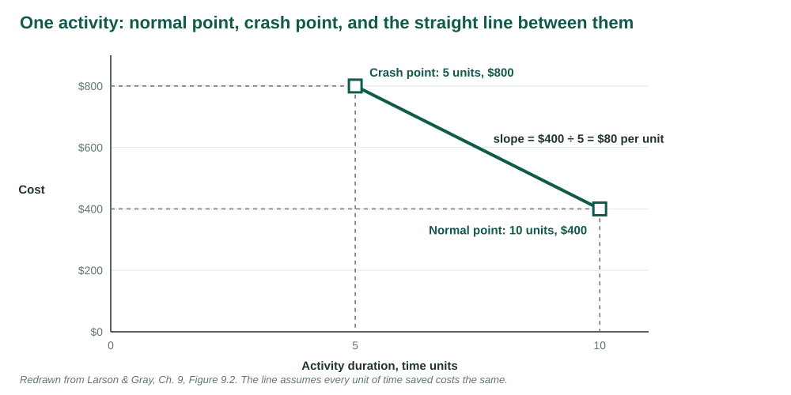
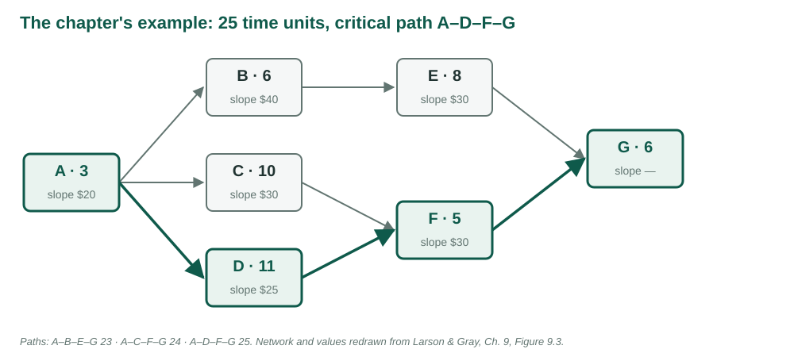
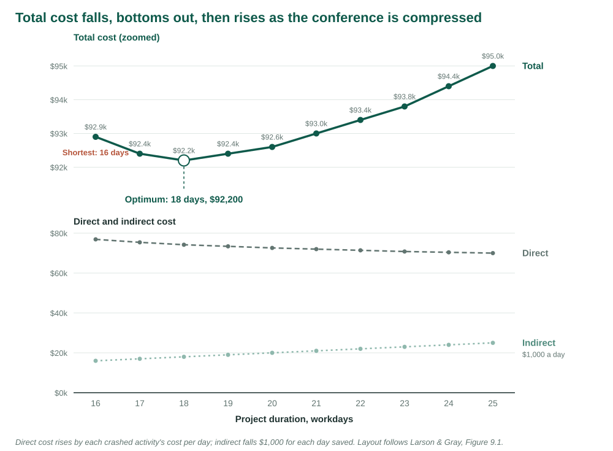

## {.center}

> Speed is the ultimate weapon in business. All else being equal, the fastest company in any market will win.

*Dave Girouard, quoted in Larson & Gray, Ch. 9 [1]. Figures redrawn from the chapter. The conference's crash estimates are original to this course.*

## What this week adds to the plan

Week 9 left the conference staffed and budgeted: 25 workdays, \$70,000 direct.

. . .

This week someone wants it sooner.

. . .

Every day can be bought. The questions are which day, at what price, and when to stop buying.

## Learning objectives

| | |
|---|---|
| **LO 9-1** | Why crash a project |
| **LO 9-2** | Options when resources are available |
| **LO 9-3** | Options when resources are constrained |
| **LO 9-4** | Find the optimum cost-time point |
| **LO 9-5** | The risks of compressing a schedule |
| **LO 9-6** | When cost, not time, is the issue |

## Six words for the week

| Term | Meaning |
|---|---|
| Crashing | Shortening a project below its normal, lowest-cost duration |
| Direct cost | Labour, materials, equipment charged to an activity |
| Indirect cost | The cost of keeping the project open, per day |
| Crash time | The shortest realistic time for an activity |
| Slope | The cost of saving one day on one activity |
| Optimum cost-time point | The duration with the lowest total cost |

# LO 9-1 · Why crash a project

::: {.aside}
Following Larson & Gray, Ch. 9, Section 9.1
:::

## Three situations

The finished schedule lands two months after a date the boss promised a customer.

. . .

Five months in, you are three weeks behind a date that cannot move.

. . .

Four months in, management says money is no object: just finish.

. . .

The plan is sound. The date is wrong.

## Six reasons to buy time

- An imposed date: contract, launch, regulator, sponsor
- Time to market
- Incentive or penalty contracts
- Recovering a slip that ate the slack
- Indirect cost: every day open costs money
- Freeing people for the next project

# LO 9-2 · When resources are available

::: {.aside}
Following Larson & Gray, Ch. 9, Section 9.2
:::

## Four ways to buy time with money

| Option | How | The catch |
|---|---|---|
| Add resources | More people or equipment on a critical activity | Coordination and training |
| Outsource | A specialist with better tools or skills | Less control |
| Overtime | More hours from the same people | Cost and fatigue |
| Do it twice | A quick interim fix now, the real one later | Paying for the work twice |

## Brooks's law

A team of *n* people has *n*(*n* − 1)/2 pairs to coordinate.

. . .

Two people: one pair. Four people: six pairs.

. . .

"Adding manpower to a late software project makes it later" [2].

. . .

Later research: not always. What matters is adding people early enough to become productive [1].

# LO 9-3 · When resources are constrained

::: {.aside}
Following Larson & Gray, Ch. 9, Section 9.2
:::

## Five ways without more money

| Option | What changes | The catch |
|---|---|---|
| Improve efficiency | Planning, fewer obstacles | Modest gains |
| Fast tracking | Sequential work overlaps | Rework if inputs change |
| Critical chain | Buffers and estimates | Hard to adopt mid-project |
| Reduce scope | What is delivered | Lost value |
| Compromise quality | How well | Rarely acceptable |

## Fast tracking, from Week 6

A finish-to-start link becomes start-to-start with a lag.

. . .

Engineers start the production line once key specifications are set, not after final approval.

. . .

Shorter, if the specifications hold. Rework, if they change.

## Reducing scope well

"You can have all of it in February, or these parts of it in December."

. . .

Requirements written in an optimistic moment include things that are desirable, not essential.

. . .

The conversation either buys time or money, or separates must from nice.

# LO 9-4 · The optimum cost-time point

::: {.aside}
Following Larson & Gray, Ch. 9, Sections 9.3 and 9.4, Figures 9.1 to 9.6
:::

## Two costs move in opposite directions

**Indirect** costs accrue every day the project is open: supervision, rent, interest. Shorten the project and they fall.

. . .

**Direct** costs belong to activities. Shorten an activity and its direct cost rises.

. . .

Total = direct + indirect. Somewhere it stops falling.

## One activity: normal point and crash point

<figure>

</figure>

## The slope

**slope = (crash cost − normal cost) ÷ (normal time − crash time)**

. . .

The cost of saving one day on that activity.

. . .

Can save: normal time − crash time.

## Five assumptions behind the line

1. Cost rises in a straight line.
2. Normal time is the low-cost way.
3. Crash time is a real limit.
4. Slope is a cost per unit of time.
5. Every shortening stays between the two points.

## The procedure

1. Find the critical path or paths.
2. Choose the cheapest way to cut **every** critical path by one day.
3. Shorten it; add its cost to direct cost; recompute the paths.
4. Repeat until no critical path can be shortened.

. . .

Total cost at each duration = direct + indirect. The optimum is the smallest total.

## The chapter's example

<figure>

</figure>

## The chapter's crash data

| Activity | Normal | Crash | Slope | Can save |
|:-:|---|---|--:|--:|
| A | 3, \$50 | 2, \$70 | \$20 | 1 |
| B | 6, \$80 | 4, \$160 | 40 | 2 |
| C | 10, \$60 | 9, \$90 | 30 | 1 |
| D | 11, \$50 | 7, \$150 | 25 | 4 |
| E | 8, \$100 | 6, \$160 | 30 | 2 |
| F | 5, \$40 | 4, \$70 | 30 | 1 |
| G | 6, \$70 | 6, \$70 | — | 0 |

Values from Figure 9.3 [1]. Direct cost \$450 at 25 units.

## The chapter's procedure, step by step

| Duration | Cut | Cost | Direct | Indirect | Total |
|:-:|---|--:|--:|--:|--:|
| 25 | — | | \$450 | \$400 | \$850 |
| 24 | A | \$20 | 470 | 350 | 820 |
| 23 | D | 25 | 495 | 300 | 795 |
| 22 | F, on two paths | 30 | 525 | 250 | **775** |
| 21 | C + D + E | 85 | 610 | 200 | 810 |

Values from Figures 9.4 and 9.5 [1].

## Two moments that carry the method

At 22: F lies on two critical paths. One \$30 cut shortens both.

. . .

At 21: every path needs its own cut. \$85 to save \$50 of indirect cost.

. . .

Optimum: 22 units, \$775. Three units earlier and \$75 cheaper than normal.

## The conference: crash estimates

| ID | Activity | Normal | Crash | Per day saved |
|:-:|---|--:|--:|--:|
| A | Approve event brief | 2 | 1 | \$1,200 |
| B | Contract venue | 5 | 3 | 700 |
| C | Draft program | 6 | 4 | 400 |
| D | Configure registration | 4 | 3 | 900 |
| E | Confirm speakers | 8 | 5 | 600 |

## The conference: crash estimates

| ID | Activity | Normal | Crash | Per day saved |
|:-:|---|--:|--:|--:|
| F | Recruit exhibitors | 5 | 3 | \$300 |
| G | Publish program | 3 | 2 | 1,500 |
| H | Prepare on-site materials | 4 | 2 | 800 |
| I | Complete rehearsal | 2 | 2 | — |

Normal: 25 workdays, \$70,000 direct. Indirect: \$1,000 a day.

## F is cheapest, and buys nothing

Critical path A–C–E–G–H–I: 25 days.

Venue path A–B–D–G–H–I: 20. Exhibitor path A–C–F–H–I: 19.

. . .

F at \$300 a day is not on the critical path.

## The conference, crashed

| Days | Shorten | Day costs | Total | Finish |
|:-:|---|--:|--:|---|
| 25 | — | | \$95,000 | Fri 4 Dec |
| 24, 23 | C | \$400 | 93,800 | Wed 2 Dec |
| 22 to 20 | E | 600 | 92,600 | Fri 27 Nov |
| 19, 18 | H, shared | 800 | **92,200** | Wed 25 Nov |
| 17 | A, shared | 1,200 | 92,400 | Tue 24 Nov |
| 16 | G, shared | 1,500 | 92,900 | Mon 23 Nov |

## Why the venue path matters at 20

At 20 days the venue path is critical too.

. . .

E shortens only the program path. Cutting it again would leave the venue path at 20.

. . .

The only cuts that shorten both are shared: H, then A, then G.

## The cost-duration graph

<figure>

</figure>

## The stopping rule

**Crash while the next day costs less than a day of indirect cost.**

. . .

H costs \$800, less than \$1,000: buy. A costs \$1,200, more than \$1,000: stop.

. . .

Optimum: 18 workdays, Wed 25 Nov, \$92,200. A week earlier and \$2,800 cheaper than normal.

## Change the price of a day

| Indirect per day | Optimum | Why |
|--:|:-:|---|
| \$700 | 20 days | H at \$800 is no longer worth it |
| \$1,000 | 18 days | H yes, A no |
| \$1,300 | 17 days | A at \$1,200 becomes worth it |

## Crashed to the limit, lost money

A coordinator books every rush option. All nine activities at crash time.

Finish: 16 workdays, Mon 23 Nov. Direct cost: \$79,800.

. . .

Total cost? Compared with doing nothing? Which crashes bought no time?

# LO 9-5 · The risks of compressing

::: {.aside}
Following Larson & Gray, Ch. 9, Section 9.5
:::

## When to draw the graph

Before the project, with no date imposed: normal times mean what they say.

. . .

After a date is imposed: the "normal" times have already been bent.

. . .

Mid-project: some options have gone. The reasoning still applies.

## The estimates are rough

"The shortest time you can realistically do it in" means different things to different people.

. . .

Crash data is rougher than normal data, so the straight line is rarely the weak point.

. . .

Exception: all-or-nothing crashing. 10 days, or 7 with a second crew, and nothing between.

## Cheapest is not always best

| Consider | Because |
|---|---|
| Risk | Rushing design can cost weeks downstream |
| Timing | Crashing early banks time against later slips |
| Resources | The cheap crash may need people already committed |
| Morale | The same group crashed every time burns out |

# LO 9-6 · When cost is the issue

::: {.aside}
Following Larson & Gray, Ch. 9, Section 9.6
:::

## Four ways to cut cost

| Option | How it saves |
|---|---|
| Reduce scope | Deliver less; any activity is a candidate, critical or not |
| Owner takes on work | The customer does what it can, agreed up front |
| Outsource | Specialists with discounts, equipment, lower overhead |
| Brainstorm | Ask the team: one found \$75,000 without cutting scope [1] |

## One sentence for the week

A day saved is worth exactly what the project costs per day. Buy the cheap days, on every critical path, and stop when the next one costs more.

# Live in Smartsheet

::: {.aside}
Two sheets, both set up the way Studio 10 sets one up: the chapter's example, then the conference. The workbooks are linked from the week page
:::

## Two sheets, one routine

*Duration* drives the dates. *Direct cost* prices each activity at its current length. The Sheet Summary adds **Workdays**, **Direct**, **Indirect** and **Total**.

. . .

Each round: read the critical paths on the Gantt, cut the cheapest way across **all** of them, read Total. Stop when it rises.

## Chapter · Step 1 · The normal plan

Time units read as workdays from Mon 2 Nov. Indirect is `=400 - 50 * (25 - [Workdays]#)`.

. . .

Read: 25 days, Fri 4 Dec, \$450 + \$400 = \$850. Critical: A–D–F–G.

. . .

A `3d` → `2d`: 24 days, \$820. D `11d` → `10d`: 23 days, \$795.

## Chapter · Step 2 · One cut, two paths

At 23 the Gantt highlights A–C–F–G too.

. . .

F lies on both: `5d` → `4d`. 22 days, Tue 1 Dec, Total **\$775**.

## Chapter · Step 3 · Three cuts for one day

All three paths are critical now, and A and F are spent.

. . .

C, D and E, one on each path: \$85 for a day worth \$50. Total \$810. Undo all three: the optimum is 22.

## Conference · Step 1 · The sheet

Same routine, nine activities, \$1,000 a day.

. . .

Read: 25 workdays, \$70,000 + \$25,000 = \$95,000. Critical: A–C–E–G–H–I.

## Conference · Step 2 · Buy the first day

Which activity? Not F: it is not critical.

. . .

C Duration `6d` → `5d`. Finish moves to Thu 3 Dec; Total to \$94,400.

. . .

C again: \$93,800. E three times: \$92,600 at 20 days.

## Conference · Step 3 · Two critical paths

At 20 days the Gantt highlights the venue path too.

. . .

E would shorten only one path. H shortens both: `4d` → `3d` → `2d`.

. . .

Read: 18 workdays, Wed 25 Nov, Total \$92,200.

## Conference · Step 4 · One day too far

A `2d` → `1d`: 17 workdays, Total \$92,400. It went up.

. . .

Undo. The optimum is where the total turned.

## Both examples, in your browser

The [marimo notebook](https://marimo.app/github.com/harunpirim/IMSE456/blob/main/files/week-10-crashing-marimo.py) runs both examples with nothing to install.

. . .

Sliders crash each activity; the critical paths, the finish and Total move as you drag. Step through the procedure, see the graph, and check every combination.

# Thursday

## Studio 10 · Find the economic optimum, not the earliest date

70 minutes, one file: the conference crashing workbook, linked from the Studio 10 page.

| Part | Minutes | What |
|---|--:|---|
| 1 · Smartsheet | 35 | Import, dependencies, cost formulas, crash day by day to the optimum |
| 2 · Colab | 25 | Check your steps exactly; move the price of a day |
| Upload | 5 | Four screenshots, the crashing table, six answers |

## Part 1 · Smartsheet

1. **Import** the workbook; row 1 as headers
2. **Dependencies** on; Gantt, critical path. Screenshot 1
3. **Direct cost** column formula and four summary fields. Check: \$95,000
4. **Crash** one day at a time, cheapest cut on every critical path, until Total rises. Screenshots 2 and 3

## Part 2 · Colab

1. Open the notebook, **Save a copy in Drive**, **Run all**
2. Compare its step log and exact check with your table. Screenshot 4
3. `INDIRECT_PER_DAY` = 700, then 1300: where does the optimum go?

Then one PDF to Blackboard as `SA10_yourlastname.pdf` before you leave.

## Sources

1. Larson, E. W., & Gray, C. F. *Project Management: The Managerial Process*, 2024 Release. McGraw Hill. Chapter 9.
2. Brooks, F. P. (1975). *The Mythical Man-Month: Essays on Software Engineering*. Addison-Wesley.
3. Kelley, J. E. (1961). Critical-path planning and scheduling: Mathematical basis. *Operations Research*, 9(3), 296–320.

::: {.aside}
The conference's crash estimates, cost-duration curve and optimum are original to these course materials.
:::
