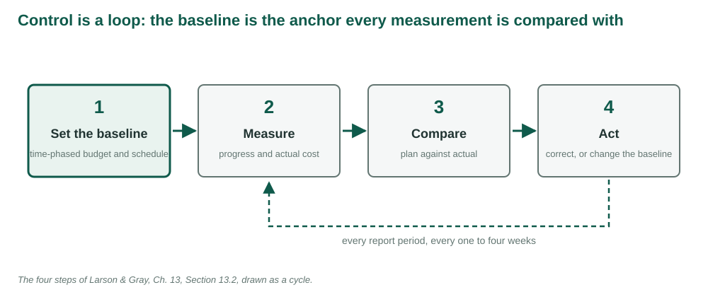
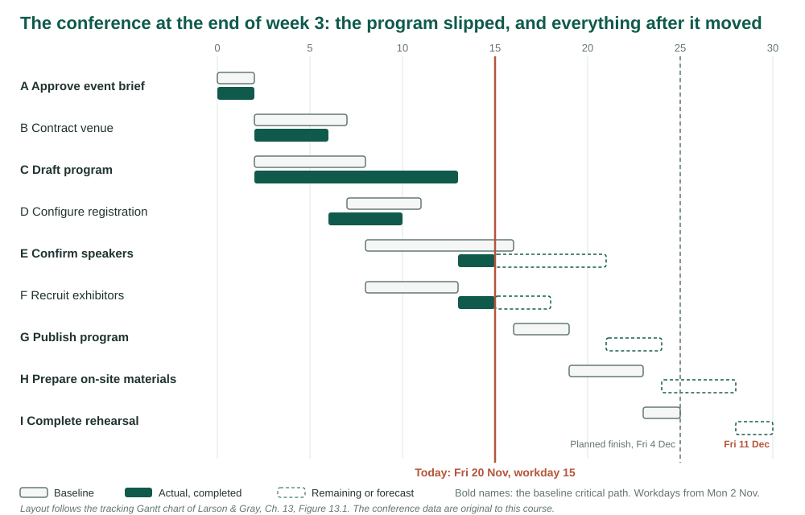
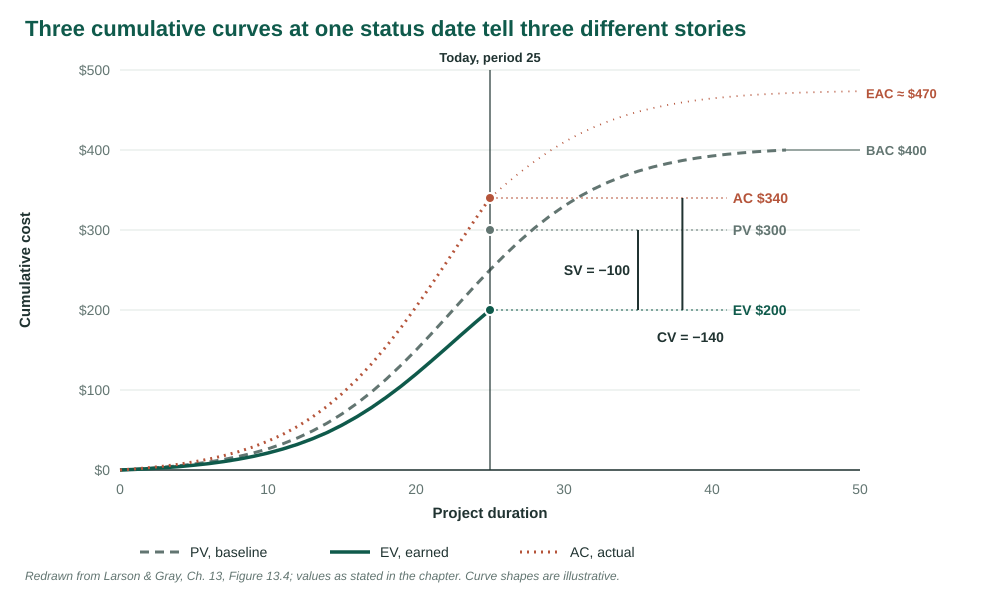
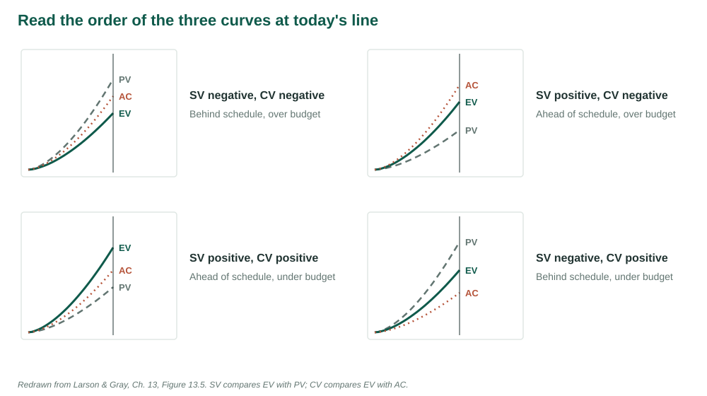
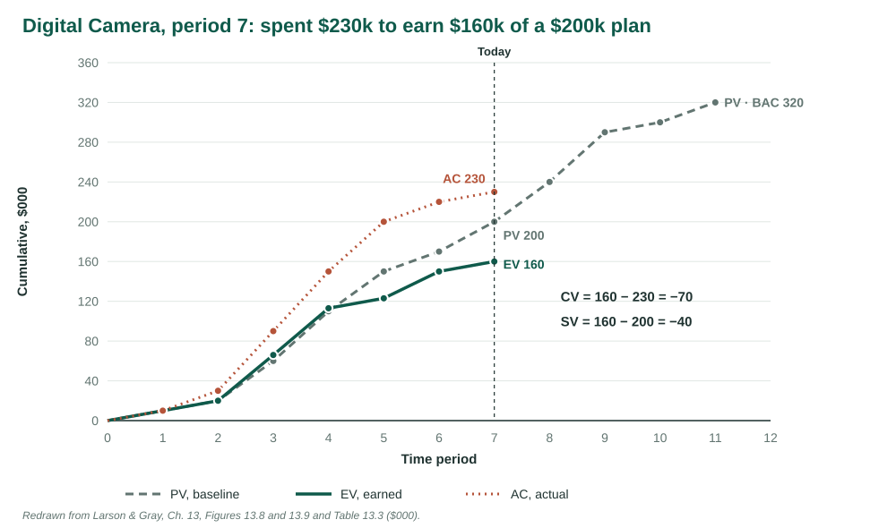
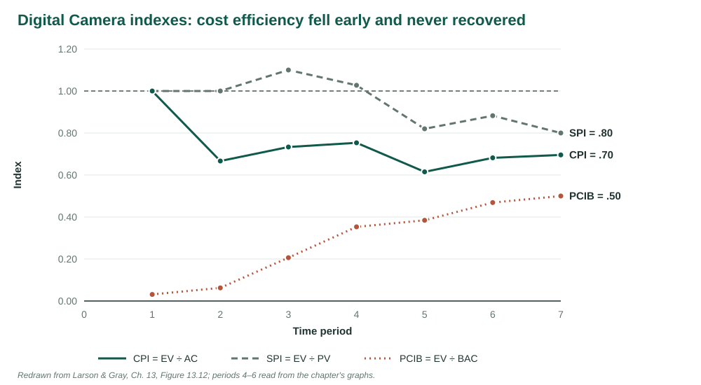
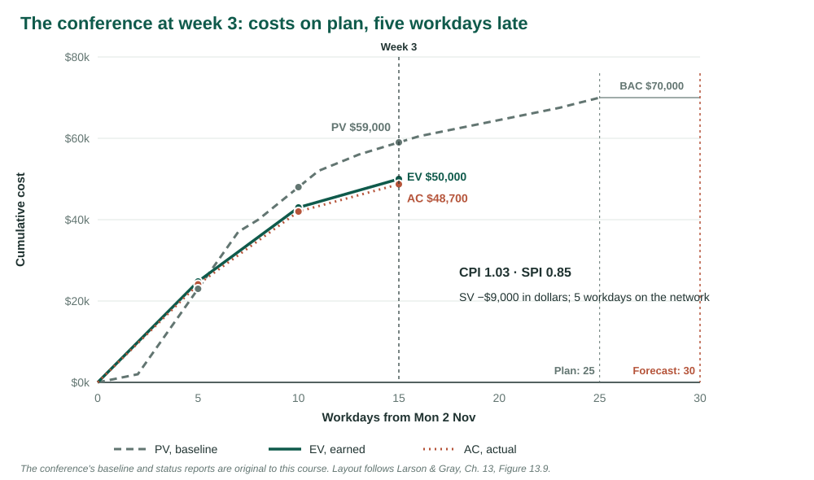

## {.center}

Ten weeks into a twenty-week, \$100,000 job, you have spent \$50,000.

. . .

Are you on plan?

*After the painting example in Larson & Gray, Ch. 13 [1]. Figures redrawn from the chapter. The conference's baseline and status reports are original to this course.*

## What this week adds to the plan

Weeks 4 to 10 built the conference's plan: scope, network, estimates, a staffed schedule, a time-phased budget, a date bought at the lowest price.

. . .

This week the conference starts. Is it going to plan?

. . .

Money spent says nothing about work done. Earned value is the number that does.

## Learning objectives

| | |
|---|---|
| **LO 13-1** | The four steps of control |
| **LO 13-2** | Monitor time with a tracking Gantt chart |
| **LO 13-3** | Why earned value is needed |
| **LO 13-4** | Cost and schedule variance |
| **LO 13-5** | Performance and percent complete indexes |
| **LO 13-6** | Forecast the final cost |
| **LO 13-7** | Scope creep and baseline changes |

## Eight words for the week

| Term | Meaning |
|---|---|
| PV | Budget of the work *scheduled* by now |
| EV | Budget of the work *done* by now |
| AC | What the work done actually cost |
| CV = EV − AC | Negative: over budget |
| SV = EV − PV | Negative: behind, in dollars |
| CPI = EV ÷ AC | Value earned per dollar spent |
| SPI = EV ÷ PV | Value earned per dollar scheduled |
| EAC | Forecast total cost |

# LO 13-1 · The four steps of control

::: {.aside}
Following Larson & Gray, Ch. 13, Sections 13.1 and 13.2
:::

## Control is a loop

<figure>

</figure>

## What the monitoring system answers

- Where are we on schedule and cost?
- What will it cost, and when will it finish?
- Which problems need attention now?
- Who, what and where is causing any overrun?

. . .

Collect the data that answer these, at the work package level, every one to four weeks.

# LO 13-2 · Monitoring time

::: {.aside}
Following Larson & Gray, Ch. 13, Section 13.3, Figure 13.1
:::

## The tracking Gantt chart

<figure>

</figure>

## Two summaries of time

**Schedule control chart.** Periods ahead or behind, plotted at each report. A trend toward late shows early.

. . .

**Milestone schedule.** Major deliverables, planned and actual dates, days early or late. For sponsors, owners and regulators.

# LO 13-3 · Why earned value

::: {.aside}
Following Larson & Gray, Ch. 13, Section 13.4, Table 13.2
:::

## Ten condos

Ten condos, two weeks and \$10,000 each. Twenty weeks, \$100,000.

. . .

Week 10: \$50,000 spent. Good weather, six painted: ahead and under budget.

. . .

Bad weather, four painted: behind and over.

. . .

Planned and actual cost cannot tell these apart.

## Earned value

The budget of the work actually done.

. . .

4½ condos painted × \$10,000 = **EV \$45,000**, whatever it cost to paint them.

. . .

PV is the anchor. AC is what it cost. EV is what it was worth.

## Five steps to an integrated system

1. Define the work: WBS, work packages, budgets
2. Schedule work and resources in a network
3. Time-phase the budgets: the baseline PV
4. Collect AC and percent complete for each work package
5. Compute the variances; roll them up by deliverable and department

Steps 1 to 3 are Weeks 4 to 9.

## The percent complete rule

EV = percent complete × budget, for each work package.

. . .

Measure it with something countable: units, drawings, cubic yards.

. . .

Many cap the credit at 80 or 90 percent until the package is finished.

. . .

Baselines hold direct cost only. The conference's \$1,000 a day of indirect cost is **not** in its \$70,000 BAC.

# LO 13-4 · Cost and schedule variance

::: {.aside}
Following Larson & Gray, Ch. 13, Sections 13.4 and 13.5, Figures 13.4 to 13.11, Table 13.3
:::

## The cost/schedule graph

<figure>

</figure>

## Read the order at today's line

<figure>

</figure>

## Digital Camera: the baseline

Six activities, \$320,000, 11 periods. Budgets laid out at early start.

| Period | 1 | 2 | 3 | 4 | 5 | 6 | 7 | 8 | 9 | 10 | 11 |
|---|--:|--:|--:|--:|--:|--:|--:|--:|--:|--:|--:|
| PV | 10 | 10 | 40 | 50 | 40 | 20 | 30 | 40 | 50 | 10 | 20 |
| Cumulative | 10 | 20 | 60 | 110 | 150 | 170 | 200 | 240 | 290 | 300 | 320 |

\$000, from Figure 13.8 [1].

## Digital Camera: period 3

| Activity | % complete | EV | AC | PV | CV | SV |
|:-:|--:|--:|--:|--:|--:|--:|
| A | finished | 20 | 30 | 20 | −10 | 0 |
| B | 33% | 5 | 10 | 5 | −5 | 0 |
| C | 20% | 20 | 30 | 20 | −10 | 0 |
| D | 60% | 21 | 20 | 15 | +1 | +6 |
| **Total** | | **66** | **90** | **60** | **−24** | **+6** |

Ahead of schedule, already over budget. Table 13.3 [1].

## Digital Camera: period 7

| Activity | % complete | EV | AC | PV | CV | SV |
|:-:|--:|--:|--:|--:|--:|--:|
| A, B, D | finished | 70 | 110 | 70 | −40 | 0 |
| C | 90% | 90 | 120 | 100 | −30 | −10 |
| E | not started | 0 | 0 | 30 | 0 | −30 |
| **Total** | | **160** | **230** | **200** | **−70** | **−40** |

Spent \$230k to earn \$160k of a \$200k plan.

## The summary graph

<figure>

</figure>

## SV is in dollars, not days

C needs six periods, not four. E and F wait. The project finishes two periods late.

. . .

Assembly shows SV −\$30k. Not Assembly's fault: its work is waiting on C.

. . .

Only the network, or the tracking Gantt chart, measures time.

# LO 13-5 · Indexes

::: {.aside}
Following Larson & Gray, Ch. 13, Section 13.6, Table 13.4, Figure 13.12, Appendix 13.1
:::

## Two efficiency ratios

| Index | Formula | > 1.00 | < 1.00 |
|---|---|---|---|
| CPI | EV ÷ AC | under cost | over cost |
| SPI | EV ÷ PV | ahead | behind |

. . .

Camera, period 7: CPI = 160 ÷ 230 = **.70**. SPI = 160 ÷ 200 = **.80**.

. . .

CPI is the trusted one: stable from about 20 percent complete.

## The indexes over time

<figure>

</figure>

## How far along?

**PCIB = EV ÷ BAC** = 160 ÷ 320 = .50. Budget view.

. . .

**PCIC = AC ÷ EAC**, with the team's re-estimate of 575: 230 ÷ 575 = .40. Spending view.

. . .

Reserve absorbed: \$70k over against a \$40k reserve. 175 percent.

## Three ways to earn value

| Rule | Earns | For |
|---|---|---|
| Percent complete | % × budget | Most work packages |
| 0/100 | All of it when finished | Very short packages |
| 50/50 | Half at start, half at finish | Short, low-cost packages |
| Weighted gates | A capped share at each gate | Long work, progress payments |

The last three need only *started* and *finished*.

# LO 13-6 · Forecasting the final cost

::: {.aside}
Following Larson & Gray, Ch. 13, Section 13.7, Exhibit 13.1
:::

## Two forecasts

**EACre = AC + ETCre**. The team re-estimates what is left.

. . .

**ETC = (BAC − EV) ÷ CPI**, **EACf = AC + ETC**. The efficiency so far continues.

. . .

Camera: ETC = 160 ÷ .696 = 230. EAC = 460. VAC = −140.

. . .

Within 10 percent on large projects past 15 percent complete [2], [3].

## To-complete performance index

**TCPI = (BAC − EV) ÷ (BAC − AC)**

. . .

Camera: (320 − 160) ÷ (320 − 230) = **1.78**.

. . .

Every remaining dollar must earn \$1.78, after earning 70 cents so far. Cut scope or raise the budget.

## A monthly report

| PV | EV | AC | CPI | EACf | BAC |
|--:|--:|--:|--:|--:|--:|
| 588,240 | 566,064 | 596,800 | .95 | 1,107,469 | 1,051,200 |

. . .

SV −\$22,176. The project is 25 days late, and that number came from the network.

. . .

The narrative names the cause: a design team lost, a \$21,000 design change.

# Your turn · The conference at week 2

::: {.aside}
Conference data original to this course. Check your work in the marimo notebook linked from the week page
:::

## The baseline, by week

| ID | Budget | Wk 1 | Wk 2 | Wk 3 | Wk 4 | Wk 5 |
|:-:|--:|--:|--:|--:|--:|--:|
| A | \$2,000 | 2,000 | | | | |
| B | 30,000 | 18,000 | 12,000 | | | |
| C | 6,000 | 3,000 | 3,000 | | | |
| D | 8,000 | | 6,000 | 2,000 | | |
| E | 12,000 | | 3,000 | 7,500 | 1,500 | |
| F | 2,500 | | 1,000 | 1,500 | | |
| G, H, I | 9,500 | | | | 4,000 | 5,500 |

Cumulative PV: 23,000 · 48,000 · 59,000 · 64,500 · 70,000.

## The week-2 report

| ID | Status | AC | EV | PV | CV | SV |
|:-:|---|--:|--:|--:|--:|--:|
| A | finished | \$2,100 | | | | |
| B | finished | 28,500 | | | | |
| C | 50% | 3,800 | | | | |
| D | finished | 7,600 | | | | |
| E, F | not started | 0 | | | | |

Fill in the table. Then CPI, SPI, PCIB, ETC, EAC, VAC, TCPI.

## Check your work

Open the [marimo notebook](https://marimo.app/github.com/harunpirim/IMSE456/blob/main/files/week-11-evm-marimo.py): conference, end of week 2.

. . .

Totals: EV \$43,000, AC \$42,000, PV \$48,000. CV +\$1,000, SV −\$5,000.

. . .

CPI 1.02, SPI 0.90. EAC \$68,372. TCPI 0.96.

. . .

Which activity's dollars make SV look small? Which activity's delay moves the finish?

# The CPI that looked good

## Week 3

| ID | Status | AC | Now expected |
|:-:|---|--:|---|
| A | finished | \$2,100 | 2 days |
| B | finished | 28,500 | 4 days (plan 5) |
| C | finished | 6,400 | 11 days (plan 6) |
| D | finished | 7,600 | 4 days |
| E | 25% | 3,200 | 8 days |
| F | 40% | 900 | 5 days |

Dashboard: CPI 1.03. EAC \$68,180, \$1,820 under budget. "Under budget and on track."

## The case question

What does the dashboard leave out?

. . .

When will the conference finish? What will it cost with \$1,000 a day of indirect cost?

. . .

What should the coordinator propose, and what would it cost?

## The dollars and the network

<figure>

</figure>

# LO 13-7 · Scope, baselines, data

::: {.aside}
Following Larson & Gray, Ch. 13, Section 13.8, Figure 13.16
:::

## Technical performance

Under budget and early, and it does not work: the project failed.

. . .

Measure against the requirements' criteria and tolerances. Put tests and inspections in the schedule.

## Scope creep

Small additions, each accepted without a price, a budget or a date.

. . .

The variances worsen for reasons the report cannot explain.

. . .

The defence: a clear scope statement and change control. Every addition is priced, approved and baselined.

## Baseline changes

Real scope change: change the baseline.

. . .

A baseline revised until it matches the results is a **rubber baseline**.

. . .

No retroactive changes. No moving money after the work is done. Unforeseen events come from contingency.

## The cost of data

Percent complete is slow and unpopular to collect.

. . .

Many small projects: pseudo percent complete, weekly work packages.

. . .

Large projects: no substitute for measured monitoring points. And a communication plan, so the data reach the people who need them.

## One sentence for the week

Earned value tells you what the money bought. Only the network tells you when you will finish. Report both.

# Thursday

## Studio 11 · Build the dashboard, then find what it hides

70 minutes, one file: the conference earned value workbook, linked from the Studio 11 page.

| Part | Minutes | What |
|---|--:|---|
| 1 · Smartsheet | 40 | Baseline, EVM columns and summary, week-3 report, dashboard, week 4 |
| 2 · Colab | 20 | Trend, the network, earning rules, a priced recovery |
| Upload | 5 | Four screenshots, the week-4 line, six answers |

## Part 1 · Smartsheet

1. **Import**; dependencies on, with % Complete mapped
2. **Set the baseline** before any status
3. Four **column formulas** and nine **summary fields**. Check: PV \$59,000
4. **Week 3** report. Screenshot 1: the baseline Gantt
5. **Dashboard**: metrics and a chart. Screenshot 2
6. **Week 4** report. Screenshot 3

## Part 2 · Colab

1. Open the notebook, **Save a copy in Drive**, **Run all**
2. Week 3: the network and the all-in cost; the cheapest recovery
3. Add week 4 and rerun. Screenshot 4: the graphs

Then one PDF to Blackboard as `SA11_yourlastname.pdf` before you leave.

## Sources

1. Larson, E. W., & Gray, C. F. *Project Management: The Managerial Process*, 2024 Release. McGraw Hill. Chapter 13.
2. Christensen, D. S. (1998). The costs and benefits of the earned value management process. *Acquisition Review Quarterly*, 5(4), 373–386.
3. Fleming, Q. W., & Koppelman, J. M. (2010). *Earned Value Project Management* (4th ed.). Project Management Institute.

::: {.aside}
The conference's baseline, status reports and forecasts are original to these course materials.
:::
