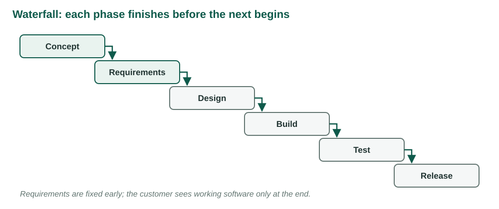
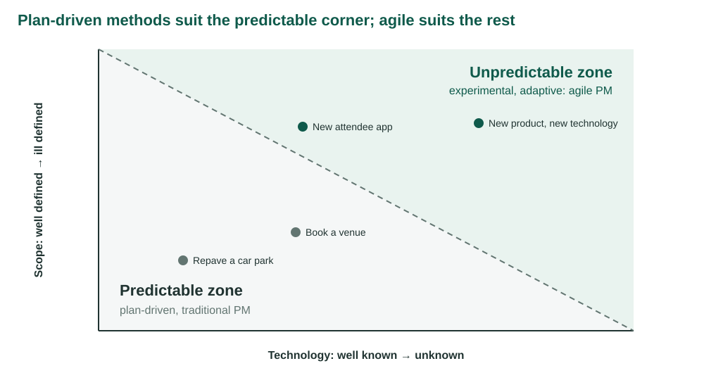
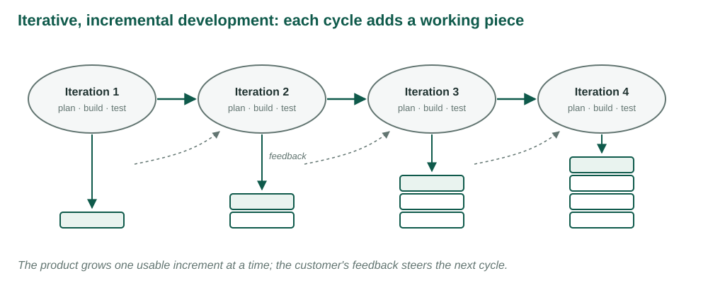
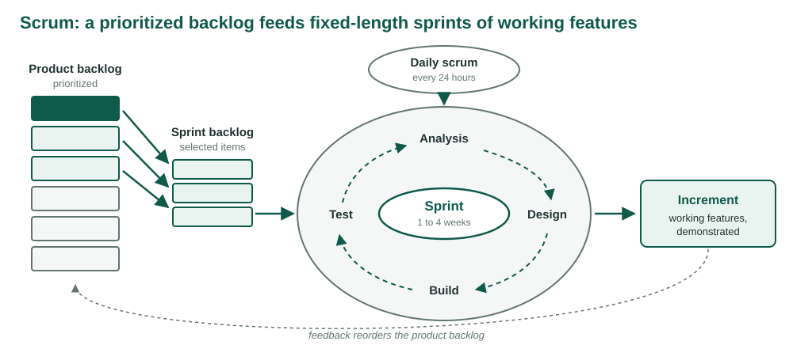
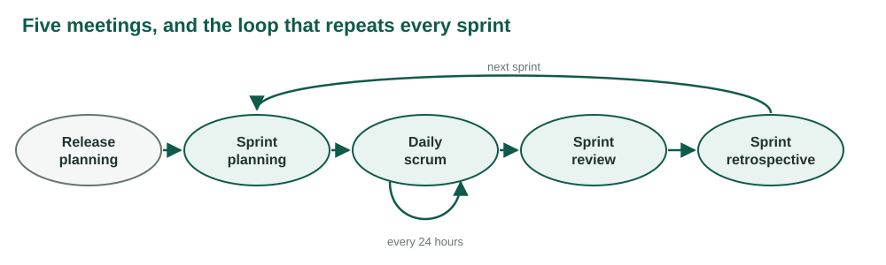
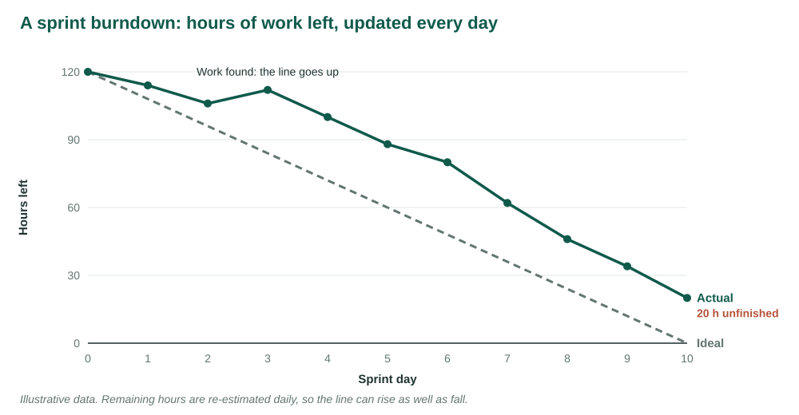
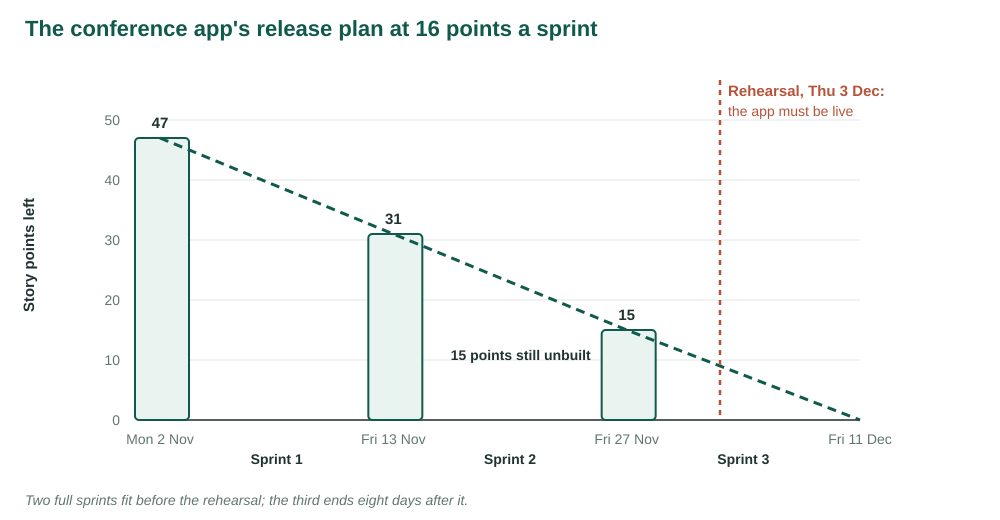
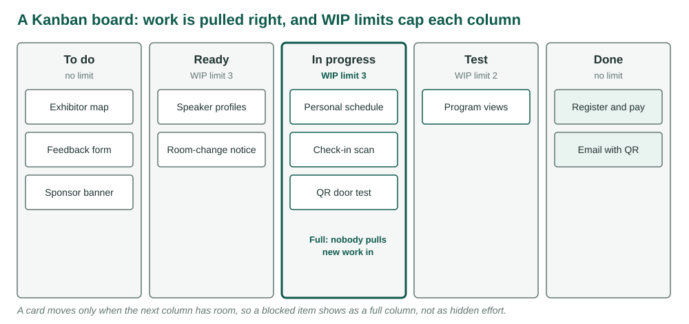

## {.center}

An attendee app: 47 points of features, a team that finishes 16 a sprint, and a rehearsal on 3 December.

. . .

The contract fixes the price, the scope and the date. Which one will give?

*Following Larson & Gray, Ch. 15 [1]. Figures redrawn from the chapter. The conference app, its backlog and its sprint are original to this course.*

## What this week adds

Weeks 4 to 11 planned the conference from the top down: scope, network, estimates, budget, baseline.

. . .

That works when everyone knows what is being built before work starts.

. . .

This week: what to do when nobody does.

## Learning objectives

| | |
|---|---|
| **LO 15-1** | When to use traditional or agile methods |
| **LO 15-2** | The value of iterative, incremental development |
| **LO 15-3** | Core agile principles |
| **LO 15-4** | Scrum |
| **LO 15-5** | Extreme Programming |
| **LO 15-6** | Kanban boards |
| **LO 15-7** | The limits of agile |

## Eight words for the week

| Term | Meaning |
|---|---|
| Sprint | A fixed 1–4 week cycle that ends in working features |
| Product backlog | Every feature wanted, in priority order |
| Sprint backlog | This sprint's tasks, owners and hours left |
| Story points | Relative size of a backlog item |
| Velocity | Points actually *finished* per sprint |
| Burndown | Work left, plotted every day |
| WIP limit | Cap on items in progress in a column |
| Cycle time | Workdays from start to done |

# LO 15-1 · Traditional versus agile

::: {.aside}
Following Larson & Gray, Ch. 15, Section 15.1
:::

## The waterfall

<figure>

</figure>

::: {.aside}
Redrawn from Larson & Gray, Ch. 15, Figure 15.1
:::

## One assumption

The essential requirements can be written down before design starts.

. . .

When it holds: efficient, predictable, easy to control.

. . .

When it fails: the customer meets the product at the end, when every misunderstanding is most expensive to fix.

## The Agile Manifesto, 2001

- *Individuals and interactions* over processes and tools
- *Working software* over comprehensive documentation
- *Customer collaboration* over contract negotiation
- *Responding to change* over following a plan

. . .

The right-hand items still matter. The left-hand items matter more.

::: {.aside}
Beck et al. (2001), agilemanifesto.org, as quoted in Larson & Gray, Ch. 15
:::

## Twelve principles, four themes

| Theme | Principles ask for |
|---|---|
| The customer | Early, continuous delivery; welcome late changes |
| Delivery | Working software every few weeks; it is the measure of progress; a sustainable pace |
| People | Business and developers daily; trust motivated people; face to face; self-organizing teams |
| Craft | Technical excellence; maximize work not done; reflect and adjust |

. . .

A mindset, not a procedure: collaboration, trust, change, customer satisfaction.

## Where each approach fits

<figure>

</figure>

::: {.aside}
Redrawn from Larson & Gray, Ch. 15, Figure 15.2 (Chapter 1's uncertainty diagram); examples added
:::

## Traditional versus agile

| Traditional | Agile |
|---|---|
| Design up front | Continuous design |
| Fixed scope | Flexible scope |
| Freeze design early | Freeze design late |
| Low uncertainty | High uncertainty |
| Avoid change | Embrace change |
| Low customer interaction | High customer interaction |
| Conventional teams | Self-organized teams |

::: {.aside}
After Larson & Gray, Ch. 15, Table 15.1
:::

# LO 15-2 · Iterative, incremental development

::: {.aside}
Following Larson & Gray, Ch. 15, Section 15.2
:::

## Build the house a room at a time

Traditional: the buyers move in when every room is finished.

. . .

Iterative: the most important room first, plumbing and wiring extended room by room.

. . .

After each room, look and adjust. The extra bedroom gets dropped; a mudroom nobody planned gets added.

::: {.aside}
Schwaber's analogy, as told in Larson & Gray, Ch. 15
:::

## Iterations and increments

<figure>

</figure>

## Rolling wave, taken to the limit

Plan the next sprint in detail. Keep the rest as an ordered list. Re-plan after every sprint.

. . .

A family of methods: Scrum, XP, Agile Modeling, Lean, RUP, Crystal Clear, DSDM, RPD.

# LO 15-3 · Six principles

::: {.aside}
Following Larson & Gray, Ch. 15, Section 15.2
:::

## What most agile methods share

| Principle | In practice |
|---|---|
| Customer value | The business orders the features |
| Iterative, incremental delivery | Small working pieces, a steady flow |
| Experiment and adapt | Prototypes to test assumptions early |
| Self-organization | The team decides what and who |
| Servant leadership | The manager facilitates, not directs |
| Continuous improvement | Work informs the plan |

# LO 15-4 · Scrum

::: {.aside}
Following Larson & Gray, Ch. 15, Section 15.3
:::

## Where the name comes from

Rugby: the whole team moves the ball together.

. . .

Takeuchi and Nonaka (1986): the best product teams overlap phases and go the distance as one group, rather than handing work over a wall.

## The Scrum process

<figure>

</figure>

::: {.aside}
Redrawn from Larson & Gray, Ch. 15, Figure 15.4
:::

## Three roles

| Role | Owns | Does not |
|---|---|---|
| Product owner | The backlog and its order; accepts or rejects each increment | Change the sprint once it starts |
| Development team | How the work is done and who does it; 5–9 people | Have titles or assigned roles |
| Scrum master | The process; removes impediments | Lead or direct the team |

. . .

The Scrum master is a coach: servant leadership, with no formal authority.

## Five meetings

<figure>

</figure>

::: {.aside}
Redrawn from Larson & Gray, Ch. 15, Figure 15.5
:::

## Planning and the daily scrum

**Release planning**: goals, top backlog, risks, a probable date and cost.

**Sprint planning**: the owner says what matters, the team says what fits. Too big for one sprint? Split it. Then the goal is frozen.

. . .

**Daily scrum**, standing, about fifteen minutes:

1. What did I finish since the last scrum?
2. What will I do before the next?
3. What is in my way?

## Review and retrospective

**Sprint review**: demonstrate the increment. The owner declares what is done; the rest returns to the product backlog.

. . .

**Sprint retrospective**: how did we work? Choose specific changes for the next sprint.

. . .

The review improves the product. The retrospective improves the team.

## The product backlog

| ID | Product | Priority | Status | Est. h | Actual h |
|---|---|---|---|---|---|
| 1 | Customer information | 2 | Complete | 100 | 90 |
| 2 | Insurance information | 1 | Complete | 160 | 180 |
| 3 | Drug information | 3 | Started | 80 | |
| 4 | Doctor information | 5 | Not started | 40 | |
| 5 | Inventory status | 4 | Started | 120 | |

::: {.aside}
Phone-In Prescription, values from Larson & Gray, Ch. 15, Figure 15.6. Owned by the product owner
:::

## The sprint backlog

| Task | Who | Actual h | Remaining h | Stage |
|---|---|---|---|---|
| Drug categories | RT | 16 | 0 | Accepted |
| Generics | CG | 32 | 0 | Accepted |
| Branded | AL | 24 | 8 | Tested |
| Design drug inventory system | EL | 40 | 0 | Accepted |
| Code inventory availability | CE | | 32 | Not started |
| Code manufacture order | MC | | 32 | Not started |
| Integrate all inventory systems | LE | 4 | 16 | Defined |

::: {.aside}
Values from Larson & Gray, Ch. 15, Figure 15.7. Owned by the team
:::

## The burndown chart

<figure>

</figure>

## Velocity

Story points: relative size, not hours.

. . .

Velocity: points the product owner **accepted** this sprint. 90 percent built scores 0.

. . .

Week 11's 0/100 rule, applied to features.

. . .

Sprints to release = points left ÷ velocity, rounded up.

# Your turn · Plan the conference app

## The product backlog

| ID | Story | Points |
|---|---|---|
| 1 | Register and pay online | 8 |
| 2 | Confirmation email with QR code | 3 |
| 3 | Browse the program by day and track | 5 |
| 4 | Check in by QR scan at the door | 8 |
| 5 | Build a personal schedule | 5 |
| 6 | Push notice of room changes | 5 |
| 7 | Speaker profiles | 3 |
| 8 | Exhibitor map | 5 |
| 9 | Session feedback form | 3 |
| 10 | Sponsor banner | 2 |

::: {.aside}
Priority order. Two-week sprints from Mon 2 Nov; velocity 16; the app must be live for the rehearsal, Thu 3 Dec
:::

## Four questions, by hand

1. Points in the backlog? Sprints needed at 16? When does the last one end?
2. Fill the sprints in priority order; a smaller story may be pulled forward when the next does not fit.
3. Sprint 1 is ten tasks, 84 hours, ten workdays. Ideal burndown rate?
4. Phone-In Prescription: estimated hours in unfinished items? Hours left in the sprint backlog?

## Check your work

| | |
|---|---|
| Backlog | 47 points; 47 ÷ 16 = 2.9, so **3 sprints**, ending Fri 11 Dec |
| Sprint 1 | Stories 1, 2, 3 = 16 |
| Sprint 2 | 4 + 5 = 13; story 6 (5) does not fit, story 7 (3) does: 16 |
| Sprint 3 | 6, 8, 9, 10 = 15 |
| Ideal rate | 84 ÷ 10 = **8.4 hours a day** |
| Phone-In | 80 + 40 + 120 = **240** h unfinished; sprint **88** h left |

# Live in Smartsheet · Plan the release

::: {.aside}
Follow along: download the product backlog workbook from the week page
:::

## Set up the board

1. Import `week-12-product-backlog.xlsx`
2. *Sprint* → Dropdown: Product backlog, Sprint 1, Sprint 2, Sprint 3
3. New column *Sprint points*, as a column formula: `=SUMIF([Sprint]:[Sprint], [Sprint]@row, [Points]:[Points])`
4. Card View → View by: Sprint; show *Points* and *Sprint points* on the cards

## Step 1 · Sprint 1

Drag in priority order: story 1, 8 points. Story 2, 11. Story 3, **16**.

. . .

Every card in the lane now reads *Sprint points* 16. The lane is full.

## Step 2 · Sprint 2

Story 4, 8 points. Story 5, 13.

. . .

Next in priority: story 6, 5 points. 18 does not fit.

. . .

Story 7, 3 points: **16**. Story 6 waits a sprint. The product owner decides; the team says what fits.

## Step 3 · Sprint 3 and the date

Stories 6, 8, 9, 10: 15 points. Sprint 3 runs Mon 30 Nov to Fri 11 Dec.

. . .

The rehearsal is Thu 3 Dec, day 4 of sprint 3.

## Step 4 · The task board

Thursday's sheet: sprint 1's ten tasks, *Status* as the lanes.

. . .

Day 1: T1, T2 and T8 move to *In progress*; T5 goes straight to *Done*. Hours left 84 → 68.

. . .

Dragging a card writes *Status* in the sheet. The summary updates as you go.

# Fixed price, fixed scope, agile process

## The contract

The sponsor's purchasing office signs every contract the same way: **\$47,000 fixed**, \$1,000 a point, all ten stories, live by **Thu 3 Dec**.

. . .

The firm agrees, and proposes Scrum: two-week sprints, 16 points each.

. . .

Its proposal promises to "welcome changing requirements" and to let the product owner reorder the backlog after every sprint.

## The release plan

<figure>

</figure>

## The case question

Which of scope, date and price can this contract actually hold fixed?

. . .

What does fixed scope do to the product owner's right to reorder, and to the firm's incentive at each sprint review?

. . .

Rewrite the deal so the date holds and Scrum works as Scrum.

# LO 15-5 · Extreme Programming

::: {.aside}
Following the learning objective in Larson & Gray, Ch. 15; practices from Beck (2000)
:::

## Good practice, turned up to the limit

| Practice | Idea |
|---|---|
| Planning game | Customer writes and orders stories; programmers estimate |
| Pair programming | Two people, one machine, constant review |
| Test-driven development | Write the test first |
| Continuous integration | Merge and test many times a day |
| Refactoring, simple design | Build only what today's stories need |
| On-site customer | A real user answers questions as they arise |
| Sustainable pace | No routine overtime |

. . .

Scrum manages the cycle; XP is how the code inside it gets written.

# LO 15-6 · Kanban

::: {.aside}
Following the learning objective in Larson & Gray, Ch. 15; method from Anderson (2010)
:::

## A Kanban board

<figure>

</figure>

## Build one in four steps

1. Map the stages work really passes through
2. Every item on a card, and only on a card
3. A WIP limit on each active column
4. Pull, don't push: move right only when there is room

. . .

No sprints, no fixed roles. Work flows continuously.

## Measuring flow

| Measure | Meaning |
|---|---|
| Cycle time | Workdays from start to done |
| Throughput | Items finished per day |
| WIP | Items started, not finished |

. . .

**Little's law**: WIP = throughput × cycle time.

. . .

Two items a day, eight in progress: four days each. Cut WIP to four: two days each.

# LO 15-7 · The limits of agile

::: {.aside}
Following the learning objective in Larson & Gray, Ch. 15
:::

## Where agile struggles

- Management wants fixed scope, date and cost at the start
- The customer is unavailable or will not prioritize
- Many teams, not one team of 5–9
- Distributed or rotating staff
- Regulated work that needs documentation
- Products that are useless until whole: a bridge at 20 percent

## Hybrid is the norm

A traditional plan for what is predictable; agile teams inside it for what is not.

. . .

The conference: venue, program and rehearsal on the network from Weeks 6 to 10. The app in sprints, landing before the rehearsal.

## One sentence for the week

When you cannot know the scope in advance, fix the time and the cost, and let the customer choose, sprint by sprint, what the money buys.

# Thursday

## Studio 12 · Run a sprint, then measure the flow you produced

Import sprint 1's backlog and burndown. Build a Card View task board with cycle-time and summary formulas.

. . .

Play ten daily scrums from the log: move cards, update hours, record the burndown.

. . .

Build the dashboard. Then hold the sprint review and retrospective: velocity, flow, release forecast.

## What to bring

- A laptop with Smartsheet open on your NDSU account
- Both workbooks from the week page, downloaded
- Tuesday's release plan: you will need sprint 2's stories

## Sources

1. Larson, E. W., & Gray, C. F. *Project Management: The Managerial Process*, 2024 Release. McGraw Hill. Chapter 15.
2. Beck, K., et al. (2001). *Manifesto for Agile Software Development*. agilemanifesto.org
3. Beck, K. (2000). *Extreme Programming Explained*. Addison-Wesley.
4. Anderson, D. J. (2010). *Kanban*. Blue Hole Press.
5. Little, J. D. C. (1961). A proof for the queuing formula L = λW. *Operations Research*, 9(3).
6. Schwaber, K., & Sutherland, J. (2020). *The Scrum Guide*.
7. Takeuchi, H., & Nonaka, I. (1986). The new new product development game. *HBR*, 64(1).

The conference app, its backlog, its sprint and the contract case are original to these course materials.
