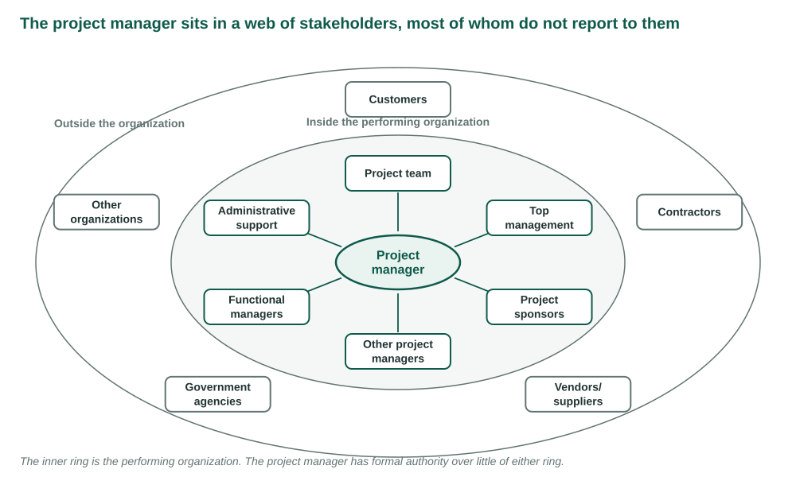
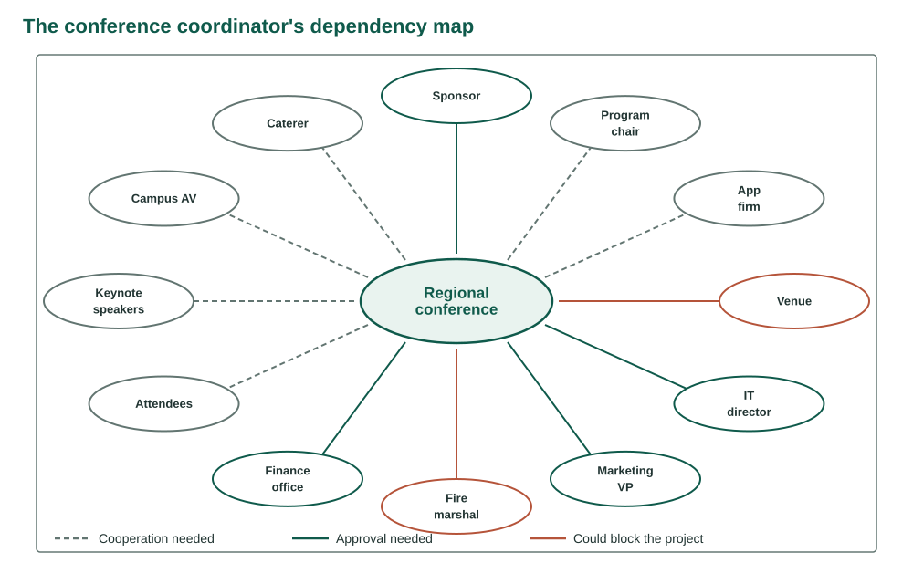
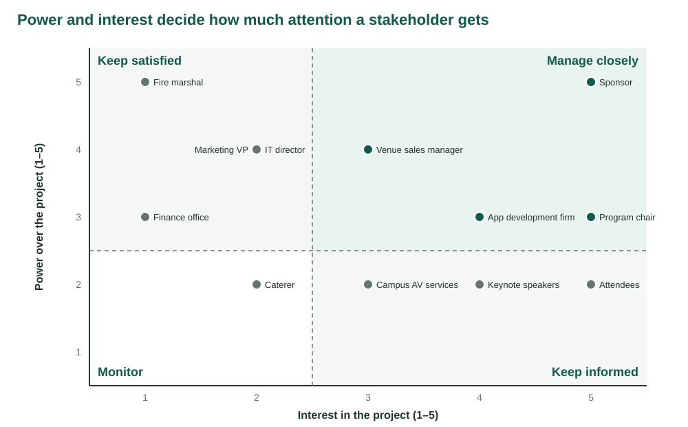
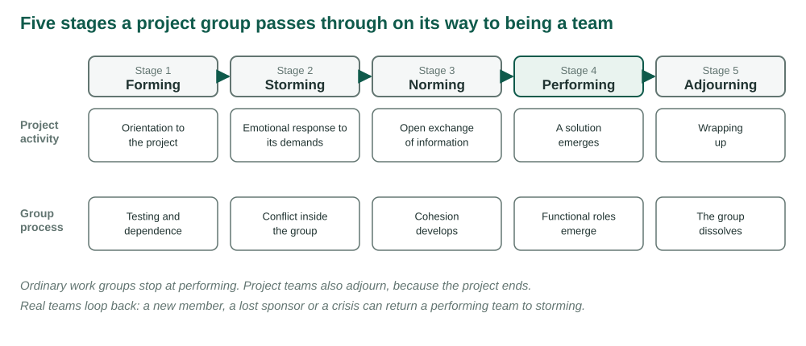
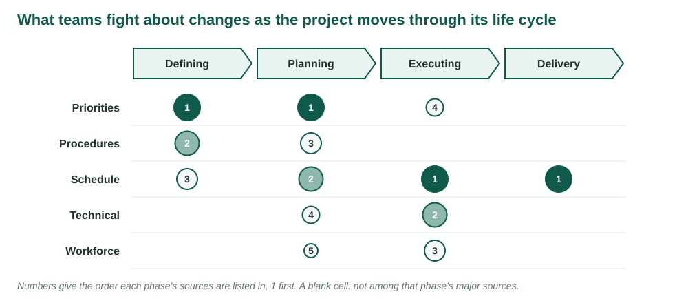

## {.center}

The sponsor said yes in a corridor. Three days later, nothing has changed.

. . .

What did that yes actually buy?

*Following Larson & Gray, Ch. 10 and 11 [1]. Figures redrawn from the chapters. The conference's stakeholders and the case are original to this course.*

## What this week adds

Weeks 4 to 12 built and measured the plan: scope, network, schedule, budget, risk, earned value, sprints.

. . .

None of it gets done by the plan. It gets done by people, and most of them do not report to the project manager.

. . .

Chapter 10: the network around the project. Chapter 11: the team inside it.

## Learning objectives · Chapter 10

| LO | Topic |
|---|---|
| **LO 10-1** | Managing versus leading |
| **LO 10-2** | Engaging stakeholders |
| **LO 10-3** | Influence currencies |
| **LO 10-4** | Stakeholder maps and dependencies |
| **LO 10-5** | An interactive management style |
| **LO 10-6** | Managing expectations |
| **LO 10-7** | Managing upward |
| **LO 10-8** | Trust and ethics |
| **LO 10-9** | Qualities of an effective project manager |

## Learning objectives · Chapter 11

| LO | Topic |
|---|---|
| **LO 11-1** | Characteristics of high-performance teams |
| **LO 11-2** | Stages of team development |
| **LO 11-3** | Situational factors |
| **LO 11-4** | Building a high-performance team |
| **LO 11-5** | Functional and dysfunctional conflict |
| **LO 11-6** | Virtual project teams |
| **LO 11-7** | Team pitfalls |

# LO 10-1 · Managing versus leading

::: {.aside}
Following Larson & Gray, Ch. 10; the distinction is Kotter's (1990)
:::

## Two jobs

| Management copes with **complexity** | Leadership copes with **change** |
|---|---|
| Plans and sets objectives | Says the direction has to change |
| Designs structures and procedures | Aligns people behind the new direction |
| Monitors against the plan | Motivates them through the obstacles |
| Corrects deviations | Sets new objectives |

. . .

The more a project changes, the more leadership it needs. A standard apartment block needs little; new software in a moving market needs a lot.

# LO 10-2 · Engaging stakeholders

::: {.aside}
Following Larson & Gray, Ch. 10
:::

## Authority is not influence

New project managers expect to manage their team.

. . .

They spend their days negotiating with people who do not report to them.

. . .

Pushing harder earns a reputation for micromanaging, and still does not produce cooperation.

## The network

<figure>

</figure>

::: {.aside}
Redrawn from Larson & Gray, Ch. 10, Figure 10.1
:::

## What each group guards

| Stakeholder | Brings | Also cares about |
|---|---|---|
| Functional managers | Staff, technical rulings | Their own operations; cooperate up to a point |
| Top management | Funding, priorities | The whole organization, not your project |
| Sponsors | Advocacy, protection | Never being surprised |
| Contractors | The work | Their margin, other clients |
| Customers | Scope and the verdict | A good deal |

. . .

The relationships interact: functional managers cool when top management does.

::: {.aside}
Summarised from Larson & Gray, Ch. 10
:::

# LO 10-3 · Influence currencies

::: {.aside}
Following Larson & Gray, Ch. 10, after Cohen and Bradford (1990)
:::

## Reciprocity

Cooperation without authority is an exchange: help given now, help returned later.

. . .

Different people value different things, so you need the right **currency** for each.

. . .

Over time, each account has to balance.

## Five families of currency

| Family | Currencies |
|---|---|
| Task | Resources · assistance · cooperation · information |
| Position | Advancement · recognition · visibility · network/contacts |
| Inspiration | Vision · excellence · ethical correctness |
| Relationship | Acceptance · personal support · understanding |
| Personal | Challenge/learning · ownership/involvement · gratitude |

. . .

Most of it is not money. A project manager with no budget can still pay in information, visibility, recognition and thanks.

::: {.aside}
Adapted from Larson & Gray, Ch. 10, Table 10.1, after Cohen and Bradford (1990)
:::

# LO 10-4 · Mapping dependencies

::: {.aside}
Following Larson & Gray, Ch. 10; power/interest grid after the chapter's Ch. 3 and Mendelow (1981)
:::

## Three questions

- Whose **cooperation** will we need?
- Whose **agreement or approval** will we need?
- Whose **opposition** could stop us?

. . .

When in doubt, add the name. Managers are derailed by the stakeholder they did not see coming.

## The conference's map

<figure>

</figure>

::: {.aside}
Layout follows Larson & Gray, Ch. 10, Figure 10.2; the conference's stakeholders are original to this course
:::

## Power and interest

<figure>

</figure>

## Four strategies

| | Low interest | High interest |
|---|---|---|
| **High power** | **Keep satisfied** | **Manage closely** |
| **Low power** | **Monitor** | **Keep informed** |

. . .

Watch the top-left corner. They rarely ask about the project, so they are easy to forget, and they can stop it.

## Step into their shoes

- How do they differ from you: goals, values, pressures, style, risks?
- Supporter, indifferent or antagonist?
- How is the relationship right now?
- Which currencies do you hold with them?

## Your turn

Open the conference stakeholder register from the week page.

1. Quadrant for each stakeholder, splitting at 3. How many in each?
2. Rank by power × interest. Top three?
3. Two stakeholders could block the conference. Which quadrant is each in? Which is more likely to be neglected?
4. Step into the IT director's shoes. Name one currency that costs no budget.

## Check your work

| Quadrant | Stakeholders |
|---|---|
| Manage closely | Sponsor, program chair, app firm, venue: **4** |
| Keep satisfied | IT director, marketing VP, fire marshal, finance office: **4** |
| Keep informed | Attendees, keynote speakers, campus AV: **3** |
| Monitor | Caterer: **1** |
| Top three | Sponsor 25, program chair 15, then app firm and venue tied at 12 |

. . .

Questions 3 and 4 we take together.

# LO 10-5 to 10-7 · Contact, expectations, upward

::: {.aside}
Following Larson & Gray, Ch. 10
:::

## Management by wandering around

Project management is a contact sport.

. . .

**MBWA**: out of the office, face to face, with a purpose. See problems early, settle conflicts before they set, be the place people go for current information.

. . .

The open-door manager waits. Attention goes to the pushiest; the quiet and the remote are ignored.

## Managing expectations

Keep in touch with the distant stakeholders too: suppliers, vendors, executives, functional managers.

. . .

Remind people of commitments. Dispel rumours. Warn early. Prepare the ground so a setback lands softly.

## Managing upward

Most friction with executives is **perspective**, not substance. Your project is one of their many.

. . .

**Earn loyalty first.** Follow through and work within limits; then your challenges get heard.

. . .

**The sponsor is first to know.** Cost overrun, technical trouble, a slipping date: they hear it from you, before anyone else.

## Leading by example

| Area | The team learns from |
|---|---|
| Priorities | Where your time goes |
| Urgency | Your own pace |
| Problem solving | How you meet bad news |
| Cooperation | How you talk about other departments |
| Standards | Your own work |
| Ethics | What you do under pressure |

::: {.aside}
After Larson & Gray, Ch. 10, Figure 10.4
:::

# LO 10-8 · Trust and ethics

::: {.aside}
Following Larson & Gray, Ch. 10
:::

## The dilemmas are common

81% of project managers in one survey meet ethical issues at work: altered status reports, backdated signatures, safety corners cut, poor work accepted.

. . .

The most common: **transparency about performance**. Tell the customer it's on track, to keep them calm?

. . .

Week 11's dashboard read "under budget and on track". The network said late.

## Grey areas, and a test

An honest error and a low-balled estimate look the same. So do optimism and exaggeration.

. . .

The front-page test: would you be comfortable reading what you did in the local paper?

. . .

Culture decides a lot. Win-at-all-costs organizations teach capable people to set their judgment aside.

# LO 10-9 · The effective project manager

::: {.aside}
Following Larson & Gray, Ch. 10
:::

## Six contradictions

- Innovate **and** keep things stable
- See the big picture **and** get your hands dirty
- Encourage individuals **and** stress the team
- Hands-off **and** hands-on
- Flexible **and** firm
- Loyal to the team **and** to the organization

## Eight traits that can be learned

| Working with others | Working on yourself |
|---|---|
| Communication | Integrity |
| Emotional intelligence | Proactivity |
| Systems thinking | Optimism |
| Business perspective | Time management |

# The sponsor who said yes

## Monday

Two weeks to the rehearsal. QR check-in needs a link from the app to the registration database.

. . .

Priya, on loan from IT at 40%, is building it. It is a week behind.

. . .

In a corridor the coordinator asks the sponsor for Priya full time. "Yes, take her. I'll square it with IT."

## Thursday

Priya is still at 40%. The IT director has heard nothing, and Priya is on her payroll cutover the same week.

. . .

"The sponsor doesn't run my department."

. . .

Same afternoon: at Tuesday's leadership meeting the sponsor said yes to the marketing VP's VIP dinner, and called the conference "green".

. . .

Venue numbers are due Friday noon. So is the status report.

## The case question

What did each yes actually secure? Where do the IT director and the marketing VP sit on the map and the grid?

. . .

What should the coordinator offer the IT director, in which currency, and what should they *not* do?

. . .

What does the coordinator tell the sponsor, in what order, and what goes in Friday's report?

# LO 11-1 · High-performance teams

::: {.aside}
Following Larson & Gray, Ch. 11
:::

## A group is not yet a team

High-performing teams share:

- a common purpose
- skills used where needed; whoever knows, leads
- balanced roles, task and morale both looked after
- energy on problems, not on rivalry
- disagreement voiced freely
- mistakes treated as lessons
- high standards, pushed by each other
- the team seen as a source of growth

# LO 11-2 · How teams develop

::: {.aside}
Following Larson & Gray, Ch. 11, after Tuckman (1965) and Tuckman and Jensen (1977)
:::

## Five stages

<figure>

</figure>

::: {.aside}
Redrawn from Larson & Gray, Ch. 11, Figure 11.1
:::

## Reading the stages

Storming is a stage, not a failure.

. . .

Teams slide back: a new member, a new sponsor, a crisis.

. . .

Project teams adjourn. Wrapping up matters more than performing at the end, and people react differently to the loss.

# LO 11-3 · The situation the team starts in

::: {.aside}
Following Larson & Gray, Ch. 11
:::

## Nine favourable conditions

| The people | The setting |
|---|---|
| 10 or fewer members | A culture of cooperation and trust |
| Volunteers | Report only to the project manager |
| Start to finish | Every relevant function represented |
| Full time | A compelling objective |
| | Within talking distance |

. . .

Few projects get all nine. Know which are missing, and work around them.

## Why ten or fewer

**Channels = n(n − 1) ÷ 2** for a team of *n* people.

. . .

| Team size | 4 | 10 | 30 |
|---|--:|--:|--:|
| Channels | 6 | 45 | 435 |

. . .

Each person added brings more channels than the last.

::: {.aside}
Channel count: PMI, PMBOK Guide (2017), Section 10.1
:::

# LO 11-4 · Building the team

::: {.aside}
Following Larson & Gray, Ch. 11
:::

## Recruiting

Ask for **volunteers**: agreeing to join is the start of commitment.

. . .

Beyond skill, look for problem solving, availability, credibility, political connections, ambition and energy.

. . .

Be wary of the technology enthusiast who would rather study than finish, and of a team that has always worked together.

## The kick-off meeting

1. Overview: scope, objectives, schedule, procedures
2. Who are the others, and where do I fit?
3. Most important: **model** how the team will work

. . .

One hour? Scope, how the team was formed, introductions. Keep it simple.

## Ground rules

| Decisions about | For example |
|---|---|
| Planning | Software, roles, cost/time/performance ranking, sign-offs |
| Tracking | Level of detail, reports, meetings |
| Change | Who approves, how it is recorded |
| Relationships | Who we work with, in what role; what we share |

::: {.aside}
Summarised from Larson & Gray, Ch. 11
:::

## Norms and the charter

- Nothing leaves the team unless everyone agrees
- Being in trouble is fine; **surprising others is not**
- No bullying through an issue
- Disagree, then commit
- Respect outsiders
- Work hard, have fun

. . .

A **team charter** puts the norms in writing and everyone signs it. It only works if the team reviews it as routinely as progress.

## Identity, vision, rewards

**Identity**: meetings, a war room, a name, a ritual. The Alpha chip team's bug roaches.

. . .

**Vision**: not the scope statement, but the shared picture of what we are creating. It shows when the plan runs out.

. . .

**Rewards**: group first, tied to the real priority. Individual rewards sparingly, and only when the team agrees.

## Deciding as a group

Use it when it improves an important decision, or when commitment matters.

. . .

1. **Identify** the problem as a gap, not a choice between X and Y
2. **Generate** alternatives, with no criticism yet
3. **Decide** against agreed criteria; don't read silence as agreement
4. **Follow up**: did it work?

# LO 11-5 · Conflict

::: {.aside}
Following Larson & Gray, Ch. 11
:::

## What teams fight about

<figure>

</figure>

::: {.aside}
Redrawn from Larson & Gray, Ch. 11, Figure 11.5, after Thamhain and Wilemon (1975)
:::

## The test

Functional or dysfunctional depends on **what it does to the project**, not how people feel.

. . .

To encourage the functional kind: agree on the priority first, worry about silence, appoint a devil's advocate, and protect the dissenter.

## Five strategies

| Strategy | What the project manager does |
|---|---|
| **Mediate** | Negotiate, find common ground |
| **Arbitrate** | Impose a solution where the project wins and both save face |
| **Control** | Lower the temperature; separate the parties |
| **Accept** | Live with what will outlast the project |
| **Eliminate** | Remove the cause, both parties if both are at fault |

::: {.aside}
After Larson & Gray, Ch. 11
:::

## Re-energizing

Informal: a new ritual, a break, the sponsor's pep talk, a friendly challenge.

. . .

Formal: a team-building session. Rank obstacles by importance and by **ownership**, work on the ones the team controls, end with owners and dates.

. . .

"Fix my team for me" does not work. The project manager's behaviour is on the agenda too.

# LO 11-6 · Virtual, mixed, hybrid

::: {.aside}
Following Larson & Gray, Ch. 11
:::

## Four working conditions

| Team | How it works |
|---|---|
| Traditional | Everyone in person, every day |
| Virtual | Spread out, mostly electronic |
| Mixed | Mostly together, some key members remote |
| Hybrid | One base, time split between office and home |

## Trust and the medium

Trust grows through reliability, consistency, responsiveness. Share backgrounds early, give everyone a task at once, start with a mini-project.

. . .

**Match the medium to the need.** Email for news; video for faces and hard calls; meet in person to build or repair trust.

. . .

**Share the pain**: rotate meeting times across time zones.

## Mixed and hybrid

Mixed: watch for **subgrouping**. Draw out the remote members and make their work visible.

. . .

Hybrid: watch for email used to avoid people you disagree with. Introverts and extroverts work best in different places.

# LO 11-7 · Team pitfalls

::: {.aside}
Following Larson & Gray, Ch. 11; groupthink is Janis's (1982)
:::

## Good things, distorted

- **Groupthink**: invulnerability, critical thinking whitewashed, outsiders stereotyped, dissenters pressured
- **Bureaucratic bypass**: skipping procedures becomes a habit; the rest of the organization pushes back
- **Infatuation**: the thrill of the project, then burnout
- **Going local**: the team starts representing the customer to its own company

. . .

Keep the team connected to the organization. Against groupthink: a devil's advocate or the nominal group technique.

## One sentence for the week

The plan says what has to happen. Whether it does depends on people who owe you nothing, so map them, learn what they value, and never let the sponsor be surprised.

# Thursday

## Studio 13 · Map the network you are actually working in

Build the stakeholder register in Smartsheet on the conference, and check it.

. . .

Then map your own final project's partner, **unaided**: register and a hand-drawn map.

. . .

Then bring in the model. Reconcile what it found, missed and got wrong. Finish with an influence plan and a look at your own team.

## What to bring

- A laptop with Smartsheet open on your NDSU account
- The conference stakeholder register, downloaded
- Paper, a pen and a phone camera
- Gemini Pro
- What you know about your partner, and nothing confidential

## Sources

1. Larson, E. W., & Gray, C. F. *Project Management: The Managerial Process*, 2024 Release. McGraw Hill. Chapters 10 and 11.
2. Kotter, J. P. (1990). *A Force for Change*. Free Press.
3. Cohen, A. R., & Bradford, D. L. (1990). *Influence without Authority*. Wiley.
4. Mendelow, A. L. (1981). Environmental scanning: The impact of the stakeholder concept. *ICIS Proceedings*.
5. Tuckman, B. W. (1965). Developmental sequence in small groups. *Psychological Bulletin*, 63(6); Tuckman & Jensen (1977).
6. Janis, I. L. (1982). *Groupthink* (2nd ed.). Houghton Mifflin.
7. PMI (2017). *PMBOK Guide* (6th ed.).
8. Thamhain, H. J., & Wilemon, D. L. (1975). Conflict management in project life cycles. *Sloan Management Review*, 16(3).

The conference's stakeholders, the case and the studio are original to these course materials.
