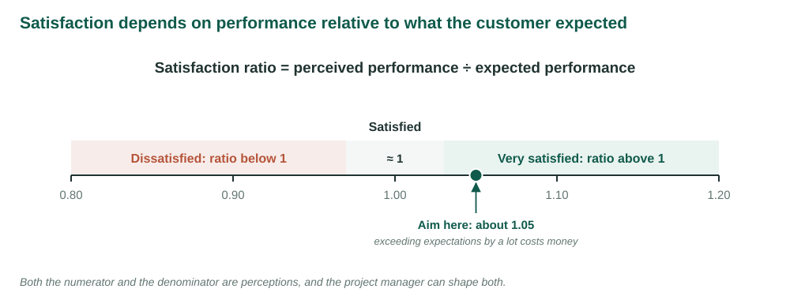
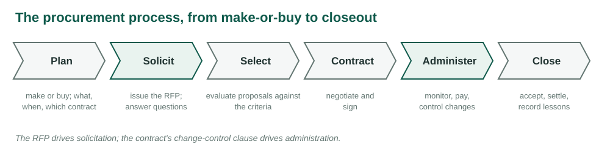
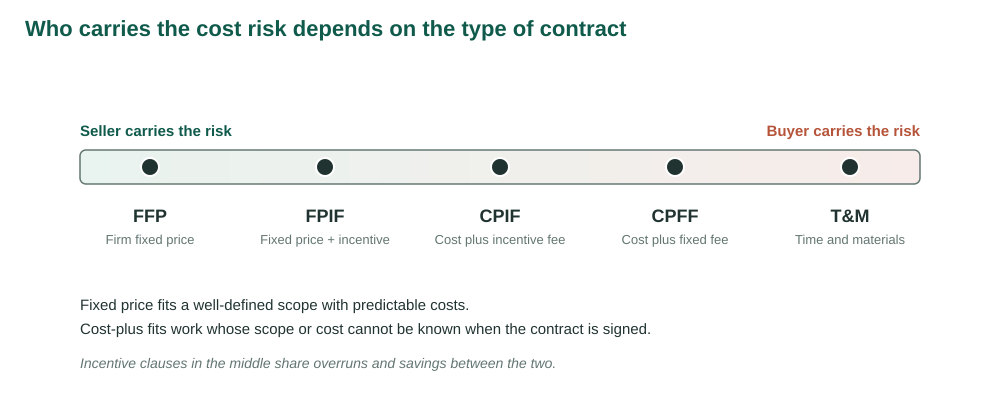
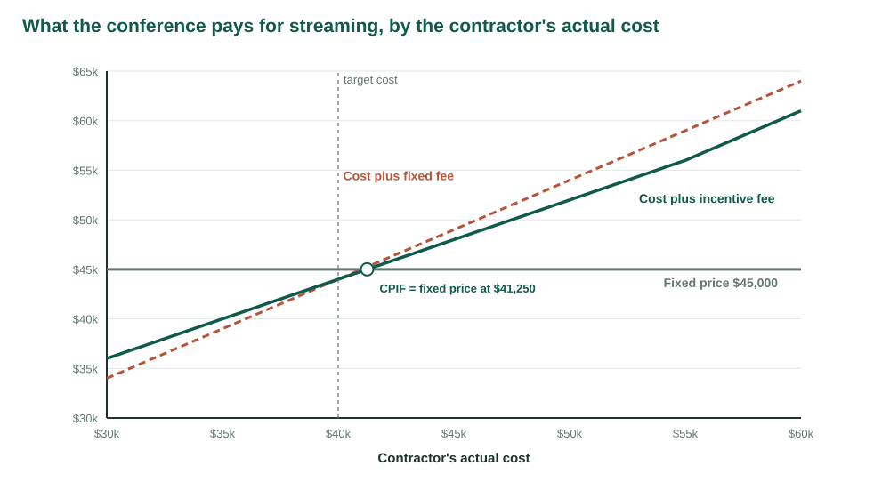

## {.center}

The streaming firm finished installation six days early and earned a bonus for it.

. . .

At the rehearsal, the stream dropped with fewer than 250 viewers.

. . .

The contract paid for exactly what it got.

*Following Larson & Gray, Ch. 12 [1]. Contract types after the PMBOK Guide [3] and FAR Part 16 [4]. The conference's contracts and the case are original to this course.*

## What this week adds

The venue, the app, the caterer, the AV crew, the stream: much of the conference is bought, not built.

. . .

Today: deciding what to buy, asking for it, choosing the contract, and working with the people on the other side.

. . .

One session this week. Thursday is Thanksgiving.

## Learning objectives

| LO | Topic |
|---|---|
| **LO 12-1** | Advantages and disadvantages of outsourcing |
| **LO 12-2** | The request for proposal |
| **LO 12-3** | Best practices in outsourcing |
| **LO 12-4** | Principled negotiation |
| **LO 12-5** | The met-expectations model |
| **LO A12-1** | The procurement process |
| **LO A12-2** | Fixed-price versus cost-plus contracts |

# LO 12-1 · Why outsource

::: {.aside}
Following Larson & Gray, Ch. 12
:::

## Four advantages

| Advantage | Because |
|---|---|
| Lower cost | Competitive prices; no in-house overhead |
| Faster completion | More people per dollar; the right equipment |
| Expertise | Focus on core competencies; hire the rest |
| Flexibility | Not limited to your own resources |

## Five disadvantages

| Disadvantage | Because |
|---|---|
| Coordination breakdowns | Different organizations, buildings, countries |
| Loss of control | No authority over the supplier |
| Conflict | Different values, priorities, cultures; trust is hard |
| Security | Secrets and confidential data leave the building |
| Political hot potato | Jobs offshore; suppliers' labour practices |

. . .

The advantages are about the **work**. The disadvantages are about the **relationship**.

# LO 12-2 · The request for proposal

::: {.aside}
Following Larson & Gray, Ch. 12, Figure 12.2
:::

## Nine elements

| # | Element |
|---|---|
| 1 | Summary of needs and request for action |
| 2 | Statement of work (SOW) |
| 3 | Deliverable specifications, requirements, features, tasks |
| 4 | Responsibilities: vendor and customer |
| 5 | Project schedule |
| 6 | Costs and payment schedule |
| 7 | Type of contract |
| 8 | Experience and staffing |
| 9 | Evaluation criteria |

::: {.aside}
Reproduced from Larson & Gray, Ch. 12, Figure 12.2
:::

## Where disputes start

**Responsibilities.** Who supplies the test equipment? Who pays for the contractor's office on site? How do issues escalate?

. . .

**Specifications.** They are how proposals get compared, and later what the work is measured against.

. . .

A vague RFP gets proposals you can't compare and a contract you can't enforce.

# LO 12-3 · Best practices

::: {.aside}
Following Larson & Gray, Ch. 12, Figure 12.4
:::

## What good outsourcers do

- Well-defined requirements and procedures
- Extensive training and team building
- Established conflict management processes
- Frequent reviews and status updates
- Co-location when needed
- Fair and incentive-laden contracts
- Long-term relationships

. . .

The theme: **partners**, not buyer and seller. Each practice answers one of the disadvantages.

::: {.aside}
Listed in Larson & Gray, Ch. 12, Figure 12.4
:::

# LO 12-4 · Principled negotiation

::: {.aside}
Following Larson & Gray, Ch. 12, Table 12.2, after Fisher, Ury and Patton
:::

## Four principles

1. Separate the people from the problem
2. Focus on interests, not positions
3. Invent options for mutual gain
4. When possible, use objective criteria

. . .

And know your **BATNA**: your best alternative to a negotiated agreement.

::: {.aside}
Reproduced from Larson & Gray, Ch. 12, Table 12.2; BATNA from Fisher, Ury and Patton (2011)
:::

## Positions and interests

**Venue:** "AV hook-up in the main hall is \$2,500 extra."

**Coordinator:** "The contract includes AV."

. . .

**Venue's interest:** its technician has to be paid for a Saturday.

**Coordinator's interest:** the stream works and the budget holds.

. . .

**Option:** our AV firm does the hook-up, the venue's technician supervises for two hours.

**Criterion:** the contract's AV clause, read together.

# LO 12-5 · Met expectations

::: {.aside}
Following Larson & Gray, Ch. 12
:::

## Satisfaction is a ratio

**Satisfaction = perceived performance ÷ expected performance**

<figure>

</figure>

::: {.aside}
Redrawn from Larson & Gray, Ch. 12, Figure 12.7
:::

## Three consequences

**Aim for about 1.05, not 1.5.** Beating expectations by a lot costs overtime and testing.

. . .

**Both terms are perceptions.** Early and under budget can still disappoint; late and over can still delight.

. . .

**Shape expectations up front, and keep doing it.** Explaining an overrun afterwards is the weakest position.

. . .

For each satisfied customer who tells one person, a dissatisfied customer tells about eight.

# LO A12-1 · The procurement process

::: {.aside}
The chapter's Appendix 12.1 is not in the excerpt; this follows the PMBOK Guide (2017), Ch. 12
:::

## From make-or-buy to closeout

<figure>

</figure>

. . .

**Contract change control**: any change to scope, price or date goes through the contract's procedure, in writing, before the work is done.

# LO A12-2 · Fixed price versus cost-plus

::: {.aside}
After Larson & Gray, Ch. 12, the PMBOK Guide (2017) and FAR Part 16
:::

## Who carries the risk

<figure>

</figure>

## Five common types

| Type | Seller is paid | Fits when |
|---|---|---|
| **FFP** | The agreed price | Scope clear, costs predictable |
| **FPIF** | Target cost + profit, shared over/underrun, up to a ceiling | Some cost uncertainty |
| **CPIF** | Actual cost + a fee that moves with cost | Uncertain, but a target can be set |
| **CPFF** | Actual cost + a fixed fee | Genuinely uncertain |
| **T&M** | Hourly rates + materials | Small or open-ended; set a ceiling |

. . .

**Cost plus a percentage of cost**: the seller earns more by spending more. Banned in U.S. federal contracting.

## The incentive fee

**Fee = target fee + seller share × (target cost − actual cost)**, between a minimum and a maximum.

. . .

At an 80/20 share, every \$1,000 saved earns the seller \$200 more fee. Every \$1,000 overrun costs it \$200.

. . .

The buyer pays actual cost + fee. The seller keeps a stake in the cost without carrying all of it.

# In class · Choose the contract

::: {.aside}
Pairs. Smartsheet open on your NDSU account; the streaming bids file from the week page downloaded
:::

## Part A · Which contract?

1. **Lunch** for 400 on both days, fixed menu, numbers confirmed a week ahead
2. **Hybrid streaming** of the main hall, in a venue whose network nobody has tested; a site survey next week settles the equipment
3. **An on-call AV technician** for the two days; hours unknown

. . .

A type, and one sentence of reason, for each.

## Part B · Three streaming bids

| Bid | Terms |
|---|---|
| 1 · FFP | \$45,000 |
| 2 · CPFF | Actual cost + \$4,000 |
| 3 · CPIF | Target cost \$40,000, target fee \$4,000, share 80/20, fee \$1,000 to \$6,000 |

. . .

**By hand first:** actual cost \$46,000. What does the conference pay under each bid, and what does each seller earn?

## Live in Smartsheet · Import

1. **+ Create → Import → Microsoft Excel**: `week-14-streaming-bids.xlsx`
2. Row 1 as headers, *Scenario* as the primary column
3. *Check:* 31 rows, \$30k to \$60k; four rows marked *Part B*; seven empty columns, *FFP pays* to *Cheapest bid*

. . .

Fill the seven empty columns: paste each formula in row 1, right-click → **Convert to Column Formula**.

## The seven formula columns

| Column | Formula |
|---|---|
| FFP pays | `=45000` |
| FFP profit | `=[FFP pays]@row - [Actual cost]@row` |
| CPFF pays | `=[Actual cost]@row + 4000` |
| CPFF fee | `=[CPFF pays]@row - [Actual cost]@row` |
| CPIF fee | `=MIN(6000, MAX(1000, 4000 + 0.2 * (40000 - [Actual cost]@row)))` |
| CPIF pays | `=[Actual cost]@row + [CPIF fee]@row` |
| Cheapest bid | `=IF(AND([CPIF pays]@row <= [FFP pays]@row, [CPIF pays]@row <= [CPFF pays]@row), "CPIF", IF([FFP pays]@row < [CPFF pays]@row, "FFP", "CPFF"))` |

::: {.aside}
Check: the \$46k row's CPIF fee reads \$2,800
:::

## Sheet Summary and dashboard

**Sheet Summary**, four fields:

- *Fixed price cheapest from* `=MIN(COLLECT([Actual cost]:[Actual cost], [Cheapest bid]:[Cheapest bid], "FFP"))`
- *Rows FFP / CPIF / CPFF cheapest* `=COUNTIF([Cheapest bid]:[Cheapest bid], "FFP")`, and the same for "CPIF" and "CPFF"

. . .

**Dashboard** *Streaming bids*:

- Line chart *What the conference pays*: Scenario, FFP pays, CPFF pays, CPIF pays
- Line chart *What the seller earns*: Scenario, FFP profit, CPFF fee, CPIF fee
- Metric widget: the four summary fields

## Answer from the dashboard

1. \$36k, \$40k, \$46k, \$55k: what does the conference pay, and what does each seller earn? Filter *Question* = Part B.
2. Where does the CPIF line cross the fixed price? Exact point from the fee formula.
3. Where does Bid 3's fee hit its maximum? Its minimum?
4. Which bid is cheapest when costs come in low? When high? You sign before anyone knows the cost: which do you sign?
5. Which line on *What the seller earns* gives no reason to control cost? Which tempts the seller to skip hard-to-verify work?

## Check your work · payments

| Actual cost | FFP pays | FFP profit | CPFF pays | CPIF fee | CPIF pays |
|---|--:|--:|--:|--:|--:|
| \$36,000 | 45,000 | 9,000 | 40,000 | 4,800 | 40,800 |
| \$40,000 | 45,000 | 5,000 | 44,000 | 4,000 | 44,000 |
| \$46,000 | 45,000 | −1,000 | 50,000 | 2,800 | 48,800 |
| \$55,000 | 45,000 | −10,000 | 59,000 | 1,000 | 56,000 |

. . .

CPIF fee: 4,000 + 0.2 × (40,000 − actual). At \$55,000 it reaches the \$1,000 minimum exactly.

## Check your work · your first chart

<figure>

</figure>

## Check your work · the rest

| Question | Answer |
|---|---|
| CPIF = FFP | 0.8 × actual + 12,000 = 45,000 → **\$41,250**; the summary shows \$42,000, the first \$1k step past it |
| Maximum fee | Actual \$30,000 or below |
| Minimum fee | Actual \$55,000 or above |
| Cheapest bid | CPFF \$30–39k (10 rows) · CPIF \$40–41k (2) · FFP \$42–60k (19) |
| No reason to control cost | **CPFF**: its fee line is flat |
| Tempted to skip hard-to-verify work | **FFP**, once costs run over: its profit line falls a dollar for every dollar spent |

# The incentive that produced the wrong behaviour

## The contract

Purchasing signed the AV and streaming contract at **cost plus 15% of cost**, "so the firm is covered".

. . .

Plus a **bonus of \$500 for each day before Mon 30 Nov** that installation is signed off.

. . .

The SOW requires a full-load test, 500 simulated viewers, before sign-off.

## What happened

Signed off Tue 24 Nov: six days early, **\$3,000** bonus.

. . .

Invoice: **\$52,000** of cost, including a second camera package and a generator nobody asked for, plus a **\$7,800** fee. Budget: \$45,000.

. . .

Rehearsal, Thu 3 Dec: the stream drops twice, under 250 viewers. The full-load test was "deferred".

## The case question

Which clause rewarded which behaviour?

. . .

Rewrite the contract, type, fee and incentive, so the firm is paid for what the conference needs.

. . .

Negotiate: each side's interests, the objective criteria, the coordinator's BATNA.

. . .

What does the sponsor now expect of the stream, and how do you manage that before the day?

## Rewarding A, hoping for B

Organizations routinely pay for one behaviour and hope for another.

. . .

A contract is a reward system for a firm. It gets the behaviour it pays for.

::: {.aside}
Kerr (1975), Academy of Management Journal, 18(4)
:::

## One sentence for the week

Buy the work, but write the contract as if the seller will do exactly what it is paid to do, because it will.

## Before Week 15

- Practice problems on the week page: an FPIF ceiling, a satisfaction ratio, an RFP with gaps
- No class Thursday: Thanksgiving
- FP4 is next: final report and presentation, 8–11 Dec

## Sources

1. Larson, E. W., & Gray, C. F. *Project Management: The Managerial Process*, 2024 Release. McGraw Hill. Chapter 12.
2. Fisher, R., Ury, W., & Patton, B. (2011). *Getting to Yes* (3rd ed.). Penguin.
3. PMI (2017). *PMBOK Guide* (6th ed.), Chapter 12.
4. Federal Acquisition Regulation, 48 C.F.R. Part 16.
5. Kerr, S. (1975). On the folly of rewarding A, while hoping for B. *Academy of Management Journal*, 18(4), 769–783.

The conference's contracts, the in-class activity and the case are original to these course materials.
