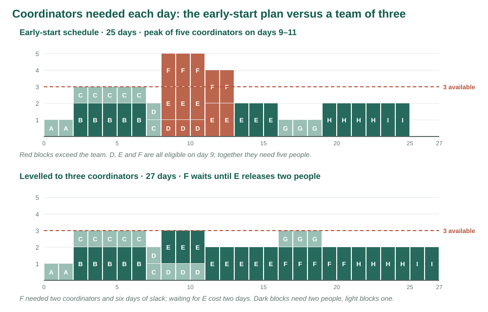
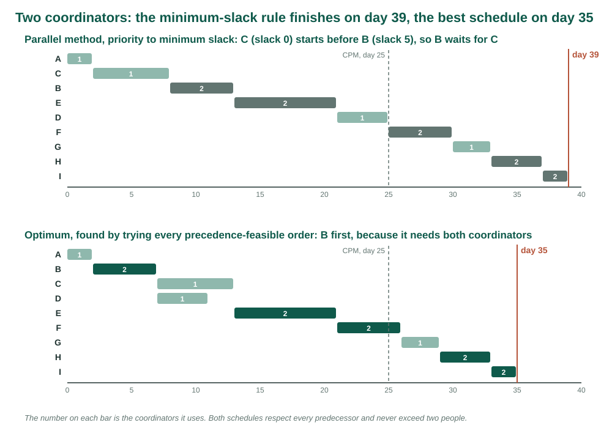
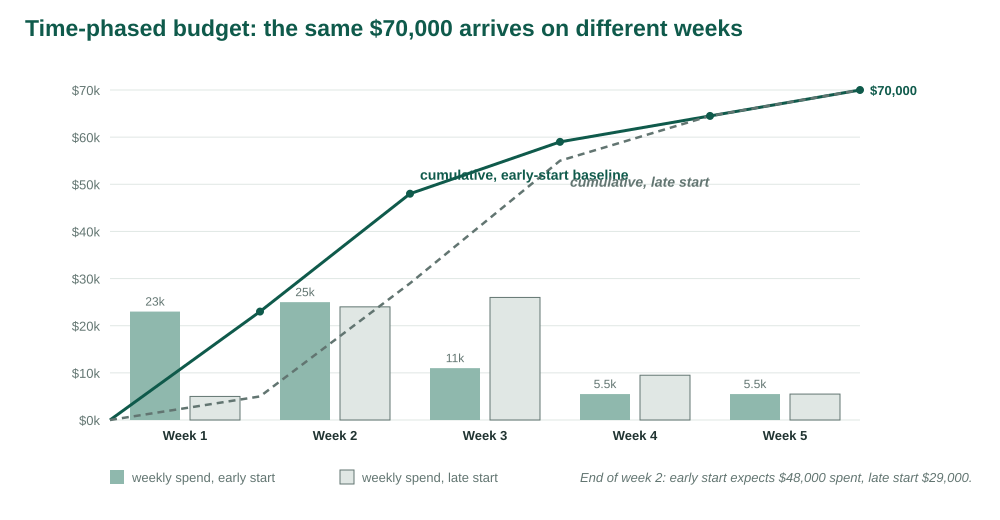

::: {.week-meta}
<dl>
<dt>Sessions</dt><dd>20 &amp; 22 October</dd>
<dt>Chapter</dt><dd>Larson Ch. 8</dd>
<dt>Tuesday</dt><dd>Everyone is at 140% in November — concept and case</dd>
<dt>Thursday</dt><dd>Heuristic versus optimal, and the price of the difference</dd>
<dt>Reading</dt><dd>Larson Ch. 8</dd>
<dt>Due</dt><dd><strong>FP2</strong> Fri 30 Oct</dd>
<dt>Studio</dt><dd>Produced in the Thursday session and uploaded to Blackboard before you leave</dd>
</dl>
:::

<!-- VIDEO -->

> Project network times are not a schedule until resources have been assigned. Cost estimates are not a budget until they have been time-phased.
>
> — Clifford F. Gray, quoted as the chapter's epigraph in Larson & Gray [1]

::: {.callout-note appearance="simple"}
**Source.** This week's notes follow Larson & Gray, *Project Management: The Managerial Process*, 2024 Release, McGraw Hill, **Chapter 8** [1]. The exposition is reworded; the classification of scheduling problems, the smoothing and levelling approaches, the parallel method and its priority rules, the multiproject problems and the case for a time-phased baseline are the chapter's. Figures 1 and 2 are redrawn from the chapter's Figures 8.1 and 8.2 and the seven-activity levelling example reproduces the values in its Figures 8.4 and 8.5; all say so where they appear. The conference's coordinator demands, costs, schedules and the optimum are original to these course materials. The three end-of-chapter exercises are reproduced as written. The claim about how well priority rules perform comes from Kolisch and Hartmann [2].
:::

## Learning objectives

| | |
|:--|:--|
| **LO 8-1** | Tell a time-constrained schedule from a resource-constrained one. |
| **LO 8-2** | Identify the kinds of resource constraint a project meets. |
| **LO 8-3** | Smooth resource demand on a time-constrained project. |
| **LO 8-4** | Level a resource-constrained project with the parallel method. |
| **LO 8-5** | Explain how scheduling software builds a resource-constrained schedule. |
| **LO 8-6** | Say when splitting an activity should be avoided. |
| **LO 8-7** | Apply general guidelines for assigning people to tasks. |
| **LO 8-8** | Identify the common problems of multiproject resource scheduling. |
| **LO 8-9** | Explain why a time-phased budget baseline is needed. |
| **LO 8-10** | Build a time-phased budget baseline from the WBS and the resource schedule. |

: {tbl-colwidths="[13,87]"}

## Concepts introduced

::: {.chips}
resource constrainttime-constrained projectresource-constrained projectresource loading chartsmoothinglevellingparallel methodpriority ruleminimum slackheuristicoptimumsplittingresource poolmultiproject schedulingcost accounttime-phased budgetbudget baselineplanned value
:::

---

# LO 8-1 · Time-constrained or resource-constrained

*Following Larson & Gray, Ch. 8, Sections 8.1 to 8.3 [1].*

Weeks 4 to 7 produced a scope, a network, estimates and a risk register. One assumption ran through all of them: whoever and whatever an activity needs will be there on the day the network says it starts. This week asks what happens to the dates when that is not true, and then turns the resulting schedule into the one thing a project can be controlled against, a budget laid out over time.

![Resource and cost scheduling is the last planning step before the master plan. Risk management feeds every step. Redrawn from Larson & Gray, Ch. 8, Figure 8.1 [1].](../images/week09/planning-process.svg){#fig-planning width=100%}

Once people have been assigned, a project manager still has to answer five questions. Will the people and equipment be enough, and available when needed? Will outside contractors be required? Are there resource dependencies the network does not show, and do they create a new critical path? How much freedom is there in moving resources around? Is the deadline still realistic? A schedule that cannot answer them is a network, not a plan.

## Two ways the network can be wrong about resources

The critical path method treats every logically parallel activity as runnable in parallel. Two things can break that.

If the resources exist but demand for them is uneven, there will be days when the early-start schedule asks for more people than usual and days when it asks for almost none. The remedy is **resource smoothing**: delay noncritical activities inside their slack so the peaks come down and the valleys fill in, without moving the finish date.

If the resources do not exist in the quantity the peak needs, something has to give. The remedy is **resource-constrained scheduling**: delay activities until the resource is free, accept a later finish, and find the sequence that makes the delay as small as possible.

The cost of not doing either shows up midway through the project, when the two activities that were supposed to run together both need the same person and the dates slip in a way nobody planned for. Chapter 8 exists because resources are usually overcommitted, and because availability and need seldom line up by themselves.

## A resource constraint changes the sequence, not the logic

The chapter's example is a wedding reception with four tasks: plan, hire the band, decorate the hall and buy refreshments. Technically the last three are independent, so after planning they can run in parallel. If one person must do all three, they run in series. The resource dependency now decides the order, but it never breaks the technical logic: every task still finishes before the reception.

![Four reception tasks. Top: technical constraints only, three tasks in parallel. Bottom: one person does all three, so the same tasks run in series. Redrawn from Larson & Gray, Ch. 8, Figure 8.2 [1].](../images/week09/constraints.svg){#fig-constraints width=100%}

The conference has the same shape. B, contract the venue, and C, draft the program, are both eligible once the event brief is approved. Nothing in the logic stops them running together. Whether they do depends on who is available in week 1.

Why not build the resources into the network from the start? Two reasons. Availability is often not known until the first schedule exists, and even when it is, nobody can see what the resources are costing the schedule unless there is a resource-neutral schedule to compare with. The network is the baseline against which the price of a resource constraint is measured.

## The classification test

Scheduling methods ask the project manager to classify the project first. The test is a single question: *if the critical path slips, will resources be added to get back on schedule?* If yes, the project is **time-constrained**; the date is fixed and resources flex, so the task is to use them efficiently. If no, the project is **resource-constrained**; the resource limit is fixed and the date flexes, so the task is to minimise the delay. The priority matrix from Week 4 already contains the answer: whichever of time and cost was marked *constrain* decides the case.

::: {.case}
### Everyone is at 140% in November

The conference plan is loaded into scheduling software and the coordinators are assigned to activities. The software's resource graph turns red for the second week: the three coordinators are needed at 167 percent of capacity on three consecutive days. A colleague in a different department has the same graph for a software release, where one analyst is at 140 percent for all of November. Both plans passed their critical-path review.

::: {.qn}
What did the critical-path review assume that the resource graph has just contradicted? Before anyone moves a date, which question decides whether this is a smoothing problem or a resource-constrained one?
:::
:::

---

# LO 8-2 · Kinds of resource constraint

*Following Larson & Gray, Ch. 8, Section 8.2 [1].*

A **resource** is anything the project draws on to do work: people, materials and equipment. Each constrains the schedule in its own way.

| Resource | How it constrains | Conference example |
|:--|:--|:--|
| **People** | Classified by skill, and skills are rarely interchangeable without a loss of productivity; the same person cannot be in two activities at once | Three event coordinators cover B through I; a coordinator can run registration setup or speaker confirmation, not both in the same week |
| **Materials** | Availability windows and delivery lead times; when a shortage is probable, the material belongs in the network as its own activity | Printed programs need five working days at the printer; order after the program is published or there is nothing to print |
| **Equipment** | Presented by type, size and quantity; the common error is to assume the pool is bigger than it is, because other projects are using it on the same day | The university's two livestream kits are booked by any department; the conference needs one for the keynote and must reserve it |

: {tbl-colwidths="[13,47,40]"}

The equipment row carries the chapter's most practical advice. Whether the organisation owns four excavators or two livestream kits, the question is not how many exist but how many are free on the day. In a multiproject organisation a **common resource pool**, checked across every project, is the only way to know, and recognising the constraint before the project starts is far cheaper than crashing or waiting when it bites.

---

# LO 8-3 · Smoothing a time-constrained project

*Following Larson & Gray, Ch. 8, Section 8.4 [1].*

Here is the Week 6 network again, with two additions: the number of coordinators each activity needs while it runs, and its direct cost. The costs are the Week 7 baseline of \$70,000, allocated to activities.

| ID | Activity | Predecessors | Days | Coordinators | Cost |
|:--:|:--|:--:|--:|--:|--:|
| A | Approve event brief | — | 2 | 1 | \$2,000 |
| B | Contract venue | A | 5 | 2 | 30,000 |
| C | Draft program | A | 6 | 1 | 6,000 |
| D | Configure registration | B | 4 | 1 | 8,000 |
| E | Confirm speakers | C | 8 | 2 | 12,000 |
| F | Recruit exhibitors | C | 5 | 2 | 2,500 |
| G | Publish program | D, E | 3 | 1 | 3,000 |
| H | Prepare on-site materials | F, G | 4 | 2 | 4,000 |
| I | Complete rehearsal | H | 2 | 2 | 2,500 |
| | **Total** | | | | **\$70,000** |

: Conference activities with coordinator demands and direct costs. Durations and predecessors are unchanged from Week 6. {tbl-colwidths="[7,33,14,10,16,20]"}

A **resource loading chart** adds up, for each day, the coordinators every scheduled activity needs. On the early-start schedule the result is uneven: one coordinator for the first two days, three while B and C run together, then five on days 9 to 11 when D, E and F are all in progress, and two or fewer for the last nine days.

{#fig-load width=100%}

Suppose the team has four coordinators, so the project is time-constrained with a little room. The peak of five can be removed without touching the finish date. F, recruit exhibitors, has six days of slack. Delaying it until D finishes on day 11 brings the load on days 9 to 11 down to three and lifts days 12 to 16 to four. F now finishes on day 16, inside its late finish of 19, and H still starts on day 19. The schedule reaches the three goals the chapter sets for smoothing: a lower peak, fewer resources needed over the life of the project, and smaller swings in demand from day to day.

The chapter's own illustration is a botanical garden built with backhoes, where delaying two noncritical activities inside their slack cuts the peak from four machines to three [1]. The lesson generalises from machines to people: moving a resource between tasks costs time, and people work better when they are not split across several things at once.

Smoothing is not free. It spends slack, and slack was the schedule's protection. After the move, F has three days of slack instead of six, and a two-week slip in E would now delay the project rather than being absorbed. Level too far, toward a perfectly flat profile, and every activity becomes critical. The usual software rule, level the activities with the most slack first, is a risk rule: those activities are the ones least likely to delay the finish when they move.

---

# LO 8-4 · Levelling a resource-constrained project

*Following Larson & Gray, Ch. 8, Section 8.4 [1].*

Now suppose the team has three coordinators and cannot get a fourth. Days 9 to 11 need five. The project is resource-constrained, and the question is no longer how to spread the load but how to delay activities so the limit is never exceeded, the technical logic is never broken, and the finish moves as little as possible.

Two assumptions keep the method learnable. An activity, once started, is not **split**: it runs to completion with the resources it was given. And the resource level does not change during the project. Neither holds in practice, and the end of this section says what splitting costs.

## Why nobody solves it exactly

The resource-constrained problem is combinatorial. Even a small network with one resource type has thousands of feasible schedules, and the number explodes with every activity and resource added. Exact methods exist, using integer programming or enumeration, and the chapter cites work from the 1970s onward that solves small networks optimally [1]; Talbot and Patterson's algorithm is the classic example [3]. For projects of realistic size, planners and software use **heuristics**: rules of thumb that build a good schedule quickly without guaranteeing the best one.

The chapter's heuristic is the **parallel method**. Step through the schedule one period at a time. In each period, list the activities that are eligible to start, meaning every predecessor is finished. Rank them by a priority rule and start as many as the resource limit allows, in that order; delay the rest to the next period and recheck. The chapter's priority rule, applied in sequence to break ties, is:

1. **minimum slack** first, where slack is recomputed as late finish minus the current period minus duration;
2. then **smallest duration**;
3. then **lowest activity identification number**.

## The chapter's seven-activity example

The chapter demonstrates the method on a network of seven activities, each needing one or two programmers, with three programmers available. Its values are reproduced here from Figures 8.4 and 8.5 [1].

| ID | Programmers | Duration | ES | LF | Slack | Predecessors |
|:--:|--:|--:|--:|--:|--:|:--:|
| 1 | 2 | 2 | 0 | 2 | 0 | — |
| 2 | 2 | 6 | 2 | 10 | 2 | 1 |
| 3 | 2 | 4 | 2 | 6 | 0 | 1 |
| 4 | 1 | 2 | 2 | 10 | 6 | 1 |
| 5 | 1 | 2 | 6 | 10 | 2 | 3 |
| 6 | 1 | 4 | 6 | 10 | 0 | 3 |
| 7 | 1 | 2 | 10 | 12 | 0 | 2, 5, 6 |

: Values from Larson & Gray, Ch. 8, Figure 8.4 [1]. The critical path is 1–3–6–7, twelve periods. {tbl-colwidths="[8,16,14,10,10,12,30]"}

The early-start load is 2, 2, 5, 5, 4, 4, 4, 4, 1, 1, 1, 1 programmers over the twelve periods. Three are available, so periods 2 to 7 are over the limit. The parallel method proceeds:

| Period | Eligible, in priority order | Decision | Programmers used |
|:--:|:--|:--|:--:|
| 0 | 1 (slack 0) | start 1 | 2 |
| 2 | 3 (slack 0), 2 (slack 2), 4 (slack 6) | start 3; 2 would make 4, delay it; start 4 | 3 |
| 4 | 2 (slack 0) | 3 still running with 2; delay 2 | 2 |
| 6 | 2 (slack −2), 6 (slack 0), 5 (slack 2) | start 2; start 6; 5 would make 4, delay it | 3 |
| 10 | 5 (slack −2) | start 5; 2 still running | 3 |
| 12 | 7 (slack −2) | start 7 | 1 |

: Period-by-period decisions. Activity 2's slack goes negative once it has waited past its late start; negative slack puts it first in the queue. {tbl-colwidths="[10,36,40,14]"}

The result finishes in fourteen periods instead of twelve. Activity 2 waited four periods for programmers, activity 5 waited four, and 7 moved with them. The load never exceeds three. Two periods is the price of having three programmers rather than five, and the method found it in six decisions.

## The conference with three coordinators

The same procedure on the conference. Nothing happens until day 8, because the load up to then is within three.

| Day | Eligible, in priority order | Decision | Coordinators used |
|:--:|:--|:--|:--:|
| 8 | E (slack 0, needs 2), F (slack 6, needs 2) | D is running with 1; start E; F would make 5, delay it | 3 |
| 11 | F (slack 3) | E still running with 2; F needs 2, delay it | 2 |
| 16 | F (slack −2), G (slack 0) | start F and G | 3 |
| 21 | H | start H when F finishes | 2 |
| 25 | I | start I | 2 |

: F needed two coordinators and had six days of slack. E held two coordinators for eight days, so F could not start until day 16, three days after its late start. {tbl-colwidths="[8,38,40,14]"}

The project finishes on day 27, two days late, and the lower panel of @fig-load shows the levelled load. F, which the critical-path analysis called comfortably noncritical, became the activity that set the finish. This is the general effect of levelling: it consumes slack, it can create a new critical sequence, and the word *critical* now means resource-critical, not just logic-critical. An activity's priority in the next levelling pass depends on a slack figure that the last pass changed.

## Heuristic versus optimal

Now the team has two coordinators. The parallel method gives a schedule of 39 days, fourteen days longer than the network. Trying every one of the 26 orders in which the nine activities can be started without breaking a predecessor gives a best schedule of 35 days. The heuristic cost four days.

{#fig-heuristic width=100%}

The reason is visible on day 2. B and C are both eligible. C has zero slack and needs one coordinator; B has five days of slack and needs two. Minimum slack starts C, and B then cannot start until C finishes on day 8, because B needs both coordinators. The optimum does the opposite: B first, for five days, then C and D together. Slack measures time, not resource weight, and the activity that monopolises the resource is the one to schedule first when the limit is tight. No single priority rule knows that. On benchmark problems, priority-rule heuristics usually finish within a few percent of the optimum, and the best modern heuristics within one or two percent [2]; on a small network with a tight limit the gap can be much larger, as it is here.

::: {.case}
### Heuristic versus optimal, and the price of the difference

The two-coordinator schedule from the parallel method finishes on day 39. A colleague who tried every order found 35. The sponsor's date is day 32 and a venue penalty of \$1,500 applies to every working day past it.

::: {.qn}
What is the price of using the heuristic on this project, in days and in dollars? Would you rather spend that money on a third coordinator for the days the schedule needs one? What would you need to know about the coordinators' availability before answering?
:::
:::

---

# LO 8-5 · How the software does it

*Following Larson & Gray, Ch. 8, Section 8.5 [1].*

Scheduling software levels resources with the same ideas and far more patience. It computes the early-start load, finds the periods over the limit, and delays activities by a priority rule, usually slack, until the limit holds. Given a resource pool and each activity's demand, it will produce a resource-constrained schedule in seconds, and it will produce a different one if the rule or the pool changes.

The chapter's software example is a medical records project of thirteen activities needing design engineers. With unlimited engineers it is 45 days; levelled to eight engineers it is 57 [1]. The three specification activities that all started on day 6 in the network were spread out, because together they needed thirteen engineers. Twelve days is the price of a team of eight, and nobody would have seen it in the network alone.

Two cautions. The software's answer is a heuristic answer: good, fast and not necessarily the best, as the two-coordinator case shows. And it is only as good as the resource data it was given. An activity with no demand entered is an activity the software thinks is free.

---

# LO 8-6 · Splitting

*Following Larson & Gray, Ch. 8, Section 8.6 [1].*

**Splitting** interrupts an activity, moves its people to something else, and brings them back later. Software offers it as a levelling option because it fills gaps neatly. The chapter's advice is to avoid it. Every interruption carries a shutdown and a restart: the work is put down in a state someone has to recover, the people have to reload what they were doing, and the restart often happens with a different mix of people. The activity's total effort goes up and its quality tends to go down. Splitting is acceptable only where the restart cost is close to zero, which is rare for thinking work and common for machine time.

---

# LO 8-7 · Assigning people

*Following Larson & Gray, Ch. 8, Section 8.7 [1].*

Levelling says when an activity runs. Assignment says who runs it. A few guidelines:

- put the strongest people on the critical and the riskiest activities, since a slip there is a slip in the finish;
- avoid loading one person with several concurrent activities, because the switching cost is paid on every one of them;
- pair experience with inexperience where the project can afford the time, and not where it cannot;
- match people to the kind of work, not only to the skill: some tasks reward breadth, others depth;
- when the software's assignment puts the wrong person on a task because the rule was blind to who they are, override it, and record why.

---

# LO 8-8 · Multiproject scheduling

*Following Larson & Gray, Ch. 8, Section 8.9 [1].*

Almost nobody schedules one project against an empty pool. Resources are shared across projects with different priorities, sizes and risks, and the system that allocates them has to absorb new projects and release finished ones continuously. The chapter names three problems that are single-project problems magnified.

| Problem | What it looks like |
|:--|:--|
| **Schedule slippage** | A delay in one project ripples into others that were waiting for the same people, as when a development team is late releasing its testers to the next project |
| **Inefficient utilisation** | The sum of several projects' demand curves has higher peaks and deeper valleys than any one of them, so an organisation staffs for the peak and idles in the valley, or staffs for normal and misses the peak |
| **Bottlenecks** | One scarce resource, a test rig or the only person qualified to sign off a design, extends every project that needs it |

: {tbl-colwidths="[24,76]"}

The organisational response is a project office that schedules across projects. The simplest rule it can apply is first come, first served: projects already under way keep their resources, and new projects are scheduled against what will be left. The rule produces reliable dates, which matters when contracts carry penalties, but it ignores priority and leaves resources idle. The priority system from Week 2 is the better basis: the resource goes to the project that ranks higher, and the lower-ranked project's schedule says so.

---

# LO 8-9 · Why the budget must be time-phased

*Following Larson & Gray, Ch. 8, Section 8.10 [1].*

The chapter's demonstration is a ten-week product development budgeted at \$400,000 a week. At the end of week 5, planned spend is \$2,000,000 and actual spend is \$2,400,000. Is the project \$400,000 over budget? Perhaps. Or the extra money bought work that was scheduled for week 6, and the project is ahead. Replace the actual with \$1,700,000 and the question flips: \$300,000 under, or behind schedule with the work not started, or both behind and over? The two numbers cannot say, because neither measures how much work was done for the money [1].

The conference has the same problem in miniature. The early-start baseline, built below, expects \$48,000 to have been spent by the end of week 2. If the invoices then total \$52,000, the venue deposit may have been larger than planned, or the venue may have been contracted a week early and the money simply arrived sooner. A budget that is a single total, or a constant burn rate, cannot distinguish these. A **time-phased budget baseline** can, because it says what should have been spent by each date for the work scheduled to that date. Week 13 builds the full comparison, earned value; this week builds the baseline it needs.

---

# LO 8-10 · Building the baseline

*Following Larson & Gray, Ch. 8, Section 8.10 [1].*

The baseline comes from two things already built: the WBS with its cost accounts, and the resource schedule. Week 4 placed each work package at the intersection of a deliverable and the unit responsible for it; the budget at that intersection is the **cost account**, the sum of a column is the deliverable's budget, the sum of a row is the unit's, and the whole rolls up to the project. Each work package, by the time it reaches this step, carries six things: what the work is, how long it takes, what it costs over time, what resources it needs, who is responsible, and how progress will be measured.

The third of those is the key. A work package's cost is spread over the weeks in which the work is expected to happen. The chapter's example is a three-week test package costing \$120,000 in labour, phased as \$40,000, \$30,000 and \$50,000 [1]. When the package is placed on the schedule, those amounts land in the three weeks the schedule gives it, and the sum over all packages for each week is the baseline. Most work packages become a single activity, so the phasing is one for one.

For the conference, the direct cost of each activity is spread evenly over its days, which gives a cost per day: \$1,000 for A, \$6,000 for B, \$1,000 for C, \$2,000 for D, \$1,500 for E, \$500 for F, \$1,000 for G, \$1,000 for H and \$1,250 for I. Placing each activity at its early start and adding up by five-day week gives the baseline.

| Week | Activities in progress | Spend | Cumulative |
|:--:|:--|--:|--:|
| 1 | A, then B and C | \$23,000 | \$23,000 |
| 2 | B and C, then D, E and F | 25,000 | 48,000 |
| 3 | D, E and F, then E alone | 11,000 | 59,000 |
| 4 | E, then G and H | 5,500 | 64,500 |
| 5 | H, then I | 5,500 | 70,000 |

: Early-start time-phased budget. The venue contract puts 80 percent of the money in the first two weeks. {tbl-colwidths="[8,52,20,20]"}

{#fig-budget width=100%}

The cumulative curve is the project's **planned value** over time. Its shape depends on the schedule as much as on the costs, which is the point of this week. Place every activity at its late start instead and the first two weeks hold \$29,000 rather than \$48,000. Level to three coordinators and the baseline stretches to six weeks. Level to two and it stretches to seven or eight, with the venue money arriving in week 2 or week 3 depending on whether the heuristic or the optimum is used.

| Schedule | Finish | Cumulative at end of week 2 | Weeks to \$70,000 |
|:--|--:|--:|--:|
| Early start | 25 days | \$48,000 | 5 |
| Late start | 25 days | 29,000 | 5 |
| Levelled, three coordinators | 27 days | 47,000 | 6 |
| Levelled, two coordinators, parallel method | 39 days | 20,000 | 8 |
| Levelled, two coordinators, optimum | 35 days | 41,000 | 7 |

: The same \$70,000 under five schedules. The baseline the project is controlled against must be the schedule it will actually run. {tbl-colwidths="[46,14,24,16]"}

Which baseline is right? The one that matches the resource-levelled schedule the team has committed to. A baseline built on the early-start network, when the project is running the three-coordinator schedule, will report every week as underspent and on time until the delay in F arrives in week 4. The resource schedule is the project's time baseline for schedule variance, and the budget phased to it is the baseline for cost variance. Neither works without the other.

## Practice exercises

::: {#chapter-exercises}
The chapter's three exercises are reproduced as written [1]. Their Gantt charts cannot be reproduced here, so each chart is transcribed into a table of the activities, durations, dates and links it shows. The calendars run seven days a week, as the charts do.

1. Consider a project with the accompanying Gantt chart. Stella is your only electrical engineer and she is responsible for activities 3 and 4, which overlap. Level the project so that Stella is only working a maximum of eight hours each day. What would the new Gantt chart look like? What would be the new project completion date?

| Activity | Duration | Scheduled | Follows | Resource |
|:--:|--:|:--|:--:|:--|
| 1 | 2 days | Mon 6 Jan – Tue 7 Jan | — | |
| 2 | 3 days | Wed 8 Jan – Fri 10 Jan | 1 | |
| 3 | 5 days | Wed 8 Jan – Sun 12 Jan | 1 | Stella |
| 4 | 3 days | Sat 11 Jan – Mon 13 Jan | 2 | Stella |
| 5 | 2 days | Mon 13 Jan – Tue 14 Jan | 3 | |
| 6 | 2 days | Wed 15 Jan – Thu 16 Jan | 4, 5 | |

: Transcribed from the exercise's Gantt chart (January 2020). {tbl-colwidths="[12,14,36,14,24]"}

Consider a project with the following Gantt chart to answer exercises 2 and 3.

| Activity | Duration | Scheduled | Follows | Resource |
|:--:|--:|:--|:--:|:--|
| 1 | 4 days | Fri 15 Feb – Mon 18 Feb | — | |
| 2 | 3 days | Tue 19 Feb – Thu 21 Feb | 1 | |
| 3 | 4 days | Tue 19 Feb – Fri 22 Feb | 1 | Bjorn |
| 4 | 4 days | Tue 19 Feb – Fri 22 Feb | 1 | Thor |
| 5 | 5 days | Mon 25 Feb – Fri 1 Mar | 2 | |
| 6 | 4 days | Mon 25 Feb – Thu 28 Feb | 3, 4 | Bjorn |
| 7 | 2 days | Fri 1 Mar – Sat 2 Mar | 6 | Thor |
| 8 | 4 days | Mon 4 Mar – Thu 7 Mar | 5, 7 | |

: Transcribed from the exercise's Gantt chart (February and March 2019). {tbl-colwidths="[12,14,36,14,24]"}

2. Bjorn and Thor are plumbers who have been scheduled to work on the construction of a new school building. Just before the start of the project, Bjorn broke his arm and cannot work on the project. Now Thor has to handle his own activities as well as Bjorn's. Level the project Gantt chart so that Thor is responsible for activities 3, 4, 6, and 7. What is the new estimated completion date for the project?

3. Suppose instead of assigning Bjorn's work to Thor, you have the opportunity to hire two new plumbers to perform Bjorn's tasks (shortening them by 50 percent). What would the new project estimated completion date be? Show your work.
:::

::: {.callout-note appearance="simple"}
Exercises are reproduced from Larson & Gray, *Project Management: The Managerial Process*, 2024 Release, McGraw Hill, Chapter 8 [1]. The chart transcriptions are this course's reading of the published figures; if a date in your copy of the chapter differs, use the chapter's. In each exercise, state the rule you used to decide which of two competing activities goes first.
:::

---

# Thursday studio

## Studio 9 · Heuristic versus optimal, and the price of the difference

Complete the [Week 9 studio](../labs/lab-09.qmd).

You will load the conference's early-start schedule and find the days it asks for more coordinators than exist. You will level it by hand with the parallel method for a team of three and then a team of two, recording every priority decision. You will then find the best two-coordinator schedule by trying every feasible order in a short Colab notebook, and put a number of days and dollars on the gap between the heuristic and the optimum. Finally you will time-phase the \$70,000 budget to the schedule you would actually run, and let Gemini level the same project cold and argue with it.

Level it yourself first. The model can produce a schedule in seconds; only you will notice whether it kept two people on B for five days or quietly split the activity.

Tuesday's session ends with the same conference built live in Smartsheet. The [Week 9 Smartsheet workbook](../files/week-09-smartsheet-resource-workout.xlsx) holds the import tab and every formula used, so you can rebuild the sheet in your own account and repeat the six steps from the deck.

## Sources

1. Larson, E. W., & Gray, C. F. *Project Management: The Managerial Process*, 2024 Release. McGraw Hill. Chapter 8.
2. Kolisch, R., & Hartmann, S. (2006). Experimental investigation of heuristics for resource-constrained project scheduling: An update. *European Journal of Operational Research*, 174(1), 23–37.
3. Talbot, F. B., & Patterson, J. H. (1978). An efficient integer programming algorithm with network cuts for solving resource-constrained scheduling problems. *Management Science*, 24(11), 1163–1174.

The conference's coordinator demands, costs, schedules, the enumeration of orders and the optimum are original to these course materials.
