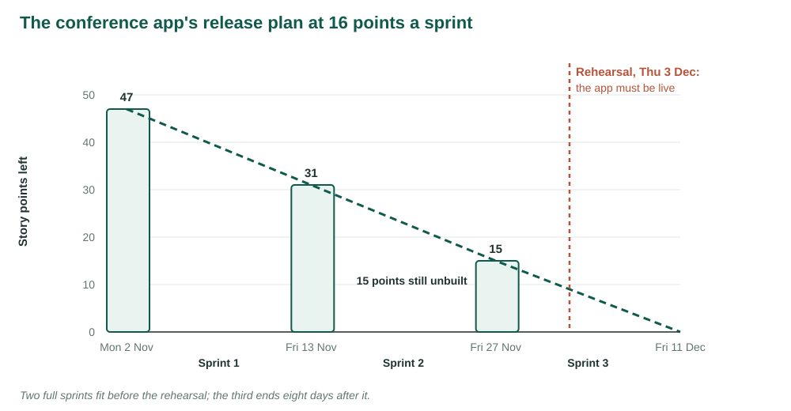
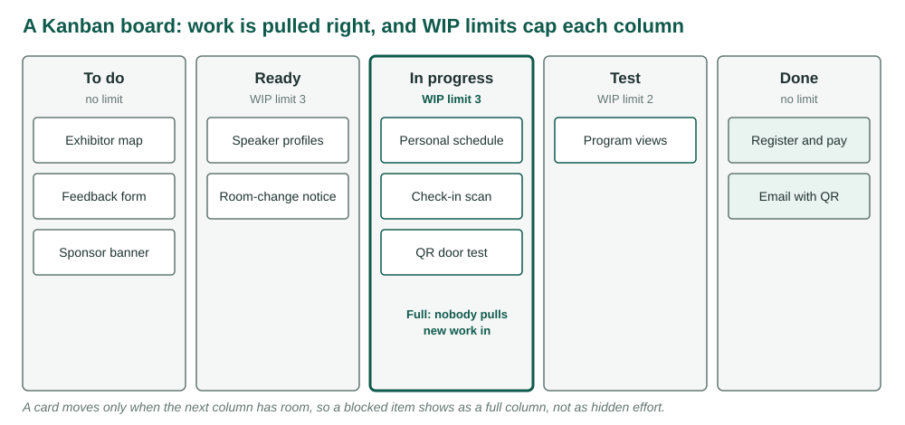

::: {.week-meta}
<dl>
<dt>Sessions</dt><dd>10 &amp; 12 November</dd>
<dt>Chapter</dt><dd>Larson Ch. 15</dd>
<dt>Tuesday</dt><dd>Fixed price, fixed scope, agile process — concept, release planning in Smartsheet, and case</dd>
<dt>Thursday</dt><dd>Run a sprint, then measure the flow you produced</dd>
<dt>Reading</dt><dd>Larson Ch. 15</dd>
<dt>Studio</dt><dd>Produced in the Thursday session and uploaded to Blackboard before you leave</dd>
</dl>
:::

<!-- VIDEO -->

::: {.callout-note appearance="simple"}
**Source.** This week's notes follow Larson & Gray, *Project Management: The Managerial Process*, 2024 Release, McGraw Hill, **Chapter 15** [1]. The exposition is reworded; the comparison of traditional and agile methods, the house analogy, the core agile principles, and the Scrum roles, meetings, backlogs and burndown charts are the chapter's, and the Phone-In Prescription backlogs reproduce the values in its Figures 15.6 and 15.7. Figures 1, 3 and 4 are redrawn from the chapter's Figures 15.1, 15.4 and 15.5; Figure 2 is redrawn from the project uncertainty diagram the chapter reuses from Chapter 1. The Agile Manifesto is quoted from its authors [2]. The sections on Extreme Programming, Kanban and the limits of agile follow the chapter's learning objectives, with the substance cited to Beck [3], Anderson [4], Little [5] and the Scrum Guide [6]. The conference attendee app, its backlog, its sprint and the contract case are original to these course materials.
:::

## Learning objectives

| | |
|:--|:--|
| **LO 15-1** | Recognize the conditions in which traditional project management versus Agile Project Management should be used. |
| **LO 15-2** | Understand the value of iterative, incremental development for creating new products. |
| **LO 15-3** | Identify core Agile principles. |
| **LO 15-4** | Understand the basic methodology used in Scrum. |
| **LO 15-5** | Understand the basic methodology used by Extreme programming. |
| **LO 15-6** | Know how to create and use a Kanban board. |
| **LO 15-7** | Recognize the limitations of Agile Project Management. |

: {tbl-colwidths="[15,85]"}

## Concepts introduced

::: {.chips}
waterfallAgile Manifestoiterative, incremental developmentrolling wave planningScrumproduct ownerScrum masterdevelopment teamsprintproduct backlogsprint backloguser storystory pointsvelocityburndown chartExtreme ProgrammingKanban boardWIP limitcycle timethroughputhybrid
:::

---

# LO 15-1 · Traditional versus agile methods

*Following Larson & Gray, Ch. 15, Section 15.1 [1].*

Weeks 4 to 11 planned the conference from the top down: a scope statement, a WBS, a network, estimates, a staffed schedule, a budget, a baseline to measure against. That works because a conference is a known kind of thing. Everyone agrees what a venue contract, a program and a rehearsal are before work begins.

Not every project is like that. When the product is new and the customer cannot say what it should do until they have used something, a plan made up front is a plan for the wrong product. **Agile Project Management** replaces the single up-front plan with short cycles that each deliver a working piece, look at it with the customer, and decide what to build next [1].

## The waterfall and its assumption

When commercial software took off in the 1980s, it was managed like any other project. The result is called the **waterfall method**: a sequence of phases, each finished and signed off before the next starts [1].

![The waterfall approach. Redrawn from Larson & Gray, Ch. 15, Figure 15.1 [1]; the excerpt shows the first three phases, and the rest are the conventional ones.](../images/week12/waterfall.svg){#fig-waterfall width=100%}

The method rests on one assumption: that the essential requirements can be written down before design begins, after which the work runs in one direction from design to release. When the assumption holds, the waterfall is efficient. When it fails, the customer meets the product for the first time at the end, and every misunderstanding surfaces when it is most expensive to fix.

## The Agile Manifesto

Frustration with heavy documentation and fixed phases came from programmers, not management. In 2001 a group of them, later the Agile Alliance, wrote the **Agile Manifesto**, which states four preferences [2]:

> Individuals and interactions over processes and tools 
> Working software over comprehensive documentation 
> Customer collaboration over contract negotiation 
> Responding to change over following a plan

The authors add that the items on the right still have value; the items on the left have more [2]. Twelve principles expand the values [1, 2]. Grouped, they say:

| Theme | What the principles ask for |
|:--|:--|
| The customer | Put valuable software in the customer's hands early and keep it coming; treat a late change in requirements as welcome. |
| Delivery | Deliver working software often, every few weeks rather than months; progress is measured in software that works; keep a pace that can be sustained indefinitely. |
| People | Business people and developers work together daily; build projects around motivated people and trust them; talk face to face; let teams organize themselves. |
| Craft | Keep attention on technical excellence and good design; maximize the work not done; reflect at regular intervals and adjust. |

: The twelve principles, grouped. Paraphrased from the Agile Manifesto [2] as listed in Larson & Gray, Ch. 15 [1]. {tbl-colwidths="[16,84]"}

Most of these concern the people doing the work. The chapter reads the manifesto as a socio-technical statement, the balance Week 1 argued for, written by people who found the technical side had been imposed on them. It describes a **mindset** that values collaboration, trust, change and customer satisfaction, not a set of procedures [1].

## Where each approach fits

Chapter 1's uncertainty diagram puts the choice on two axes: how well the scope is defined, and how well the technology is understood [1].

![Project uncertainty and the choice of method. Redrawn from the project uncertainty diagram in Larson & Gray, Ch. 15, Figure 15.2, which reuses Chapter 1's [1]. The example projects are added.](../images/week12/uncertainty.svg){#fig-uncertainty width=100%}

Traditional methods were built for the **predictable zone**: scope settled, technology known. Agile is for the **unpredictable zone**, where the work is closer to experiment than execution. In the chapter's words, projects there *evolve rather than are executed*, and solutions are *discovered rather than implemented* [1].

| Traditional | Agile |
|:--|:--|
| Design up front | Continuous design |
| Fixed scope | Flexible scope |
| Deliverables | Features and requirements |
| Freeze design as early as possible | Freeze design as late as possible |
| Low uncertainty | High uncertainty |
| Avoid change | Embrace change |
| Low customer interaction | High customer interaction |
| Conventional project teams | Self-organized project teams |

: Traditional versus agile project management. Reproduced from Larson & Gray, Ch. 15, Table 15.1 [1]. {tbl-colwidths="[50,50]"}

The conference itself sits in the predictable zone, and the course has managed it that way. The attendee app the sponsor has commissioned alongside it does not: nobody yet knows which features attendees will actually use.

---

# LO 15-2 · Iterative, incremental development

*Following Larson & Gray, Ch. 15, Section 15.2 [1].*

Ken Schwaber, one of Scrum's authors, explains **iterative, incremental development (IID)** with a house [1]. Built the traditional way, the buyers move in only when every room is finished. Built iteratively, the house goes up a room at a time, the most important room first, with the plumbing and wiring extended as each room is added. After each room, builders and buyers look at what exists and adjust. The buyers drop the extra room they were sure they needed, and add things they had not thought of. The house ends up fitting how they actually live.

![Iterative, incremental development. Original figure, drawn for these notes from the description in Larson & Gray, Ch. 15, Section 15.2 [1].](../images/week12/iid.svg){#fig-iid width=100%}

Two words do different work here. **Iterative** means the cycle repeats: plan, build, test, review, again. **Incremental** means each cycle adds a usable piece rather than a layer of an unusable whole. Four weeks of waterfall produce a requirements document; four weeks of IID produce something a customer can try.

Agile is **rolling wave planning** taken to its limit [1]. Week 4 used rolling waves for work packages too distant to detail. Agile plans the next sprint in detail and leaves everything after it as a prioritized list, re-planned at the end of each sprint with what has been learned.

Agile is a family of methods, not one [1]. The chapter lists Scrum, Extreme Programming (XP), Agile Modeling, Lean Development, the Rational Unified Process (RUP), Crystal Clear, the Dynamic Systems Development Method (DSDM) and Rapid Product Development (RPD). This week covers Scrum, XP and Kanban.

---

# LO 15-3 · Core agile principles

*Following Larson & Gray, Ch. 15, Section 15.2 [1].*

The methods differ in detail, but most share six principles [1]:

- **Focus on customer value.** Priorities among requirements and features are set by the business, in order of value.
- **Iterative and incremental delivery.** Value reaches the customer in small, working pieces, as a steady flow.
- **Experimentation and adaptation.** Assumptions are tested early; working prototypes draw out feedback that sharpens the requirements.
- **Self-organization.** The people doing the work choose the tasks and divide them up.
- **Servant leadership.** The project manager supports and facilitates; the team is not directed.
- **Continuous improvement.** The team reflects, learns and adapts; the work informs the plan.

Set them beside Weeks 4 to 11. The WBS, the network and the baseline still exist in spirit, but they are made one sprint at a time and owned by the team doing the work.

---

# LO 15-4 · Scrum

*Following Larson & Gray, Ch. 15, Section 15.3 [1].*

Scrum takes its name from rugby, where the whole team moves the ball down the field together. Takeuchi and Nonaka used the image in 1986 to describe how the best product development teams worked: overlapping phases, one cross-functional team, the whole group going the distance together rather than handing work over a wall [1, 7].

![The Scrum development process. Redrawn from Larson & Gray, Ch. 15, Figure 15.4 [1].](../images/week12/scrum-process.svg){#fig-scrum width=100%}

A Scrum project is a run of fixed-length **sprints**, one to four weeks each. The **product backlog** holds every feature the product might have, in priority order. At the start of each sprint the team takes the top items it can finish into a **sprint backlog** and builds them: analysis, design, build and test happen inside the sprint, not in separate phases. A short **daily scrum** keeps the team aligned. At the end the team demonstrates a working **increment**, and what the customer says about it reorders the product backlog for the next sprint.

## Three roles

**Product owner.** Speaks for the customers and end users. On a commercial product it may be the product manager; on an internal one, the manager of the group that will use the software; elsewhere, a client representative. The product owner builds and orders the product backlog, often refining features into stories and use cases with the team, and negotiates each sprint's goal. They may change features and priorities between sprints but **not once a sprint has started**. They accept or reject each increment, decide when the product is finished, and watch the cost [1].

**Development team.** Delivers the product. Typically five to nine people with cross-functional skills and no fixed titles; people take on whatever the work needs. The team is **self-organizing**: it decides who does the work and how. Members ideally sit together so that face-to-face conversation is constant, and they own the commitments they make at sprint planning and review [1].

**Scrum master.** Facilitates the process and removes impediments, inside the team and in the wider organization. The Scrum master is not the team's leader and holds no formal authority. Their job is to keep the process honest, shield the team from outside interference, help the product owner plan and keep the team energized: more coach than manager. The chapter calls this **servant leadership** [1].

The 2020 Scrum Guide calls the team "developers" and makes the Scrum master accountable for the team's effectiveness [6], but the division of labour is the same.

## Five meetings

![Scrum meetings. Redrawn from Larson & Gray, Ch. 15, Figure 15.5 [1].](../images/week12/scrum-meetings.svg){#fig-meetings width=100%}

- **Release planning.** Once per release. The product owner, team and Scrum master set the goals and the overall plan: the highest-priority backlog, the main risks, the features the release will contain, a probable delivery date and an initial cost estimate. Management then tracks progress and adjusts the plan sprint by sprint [1].
- **Sprint planning.** Opens every sprint. The product owner says which items matter most; the team says how much can be done. An item too large to finish in one sprint is broken into pieces that can be [1]. The chosen items become tasks, each with an owner, in the sprint backlog. After planning closes, the sprint's goals are fixed [1].
- **Daily scrum.** Same time, same place, every workday, standing up and usually fifteen minutes. Each member says what they finished since the last scrum, what they will do before the next, and what is in their way [1, 6]. Problems are named here and solved afterwards, by the people they concern. Impediments go to the Scrum master.
- **Sprint review.** Closes every sprint: the team demonstrates the increment to the product owner and other stakeholders. The product owner rules on what is done; anything unfinished returns to the product backlog. The team can suggest improvements, which the product owner takes or declines. The review is where the product is examined and the requirements refined [1].
- **Sprint retrospective.** Then the team, facilitated by the Scrum master, looks at how the sprint went and chooses specific changes to how it works in the next one. The review improves the product; the retrospective improves the team [1].

## Product and sprint backlogs

The **product backlog** belongs to the product owner: the customer's prioritized list of features, each with an estimate of the work it will take. The chapter's example is a phone-in prescription system [1]:

| ID | Product | Priority | Status | Estimate hours | Actual hours |
|:--:|:--|:--:|:--|--:|--:|
| 1 | Customer information | 2 | Complete | 100 | 90 |
| 2 | Insurance information | 1 | Complete | 160 | 180 |
| 3 | Drug information | 3 | Started | 80 | |
| 4 | Doctor information | 5 | Not started | 40 | |
| 5 | Inventory status | 4 | Started | 120 | |

: Partial product backlog, Phone-In Prescription Software Project. Values reproduced from Larson & Gray, Ch. 15, Figure 15.6 [1]. {tbl-colwidths="[8,32,12,18,15,15]"}

The **sprint backlog** belongs to the team. It lists the tasks that deliver this sprint's features, who is responsible for each, the hours spent and the hours left, and where each task stands [1]:

::: {style="overflow-x: auto"}
| Sprint task | Responsible | Actual hours | Remaining hours | Defined | In progress | Tested | Accepted |
|:--|:--:|--:|--:|:--:|:--:|:--:|:--:|
| Drug categories | RT | 16 | 0 | ✓ | ✓ | ✓ | ✓ |
| Generics | CG | 32 | 0 | ✓ | ✓ | ✓ | ✓ |
| Branded | AL | 24 | 8 | ✓ | ✓ | ✓ | |
| Design drug inventory system | EL | 40 | 0 | ✓ | ✓ | ✓ | ✓ |
| Code inventory availability | CE | | 32 | | | | |
| Code manufacture order | MC | | 32 | | | | |
| Integrate all inventory systems | LE | 4 | 16 | ✓ | | | |

: Partial sprint backlog, Phone-In Prescription Software Project. Values reproduced from Larson & Gray, Ch. 15, Figure 15.7 [1].
:::

The sprint backlog is a status report as well as a plan. Its *Remaining hours* column is the number Scrum tracks.

## Burndown charts and velocity

Agile measures what remains rather than predicting from what has been spent. A **sprint burndown chart** plots, each day, the hours of work left in the sprint backlog, the sum of the remaining estimates of every unfinished task [1]. A straight **ideal line** runs from the committed total on day 0 to zero on the last day.

![A sprint burndown chart. Illustrative data; layout follows the description of sprint burndown charts in Larson & Gray, Ch. 15 [1].](../images/week12/burndown.svg){#fig-burndown width=100%}

Remaining hours are re-estimated every day, so the line can rise: a task turns out bigger than thought, or work is found. A line above the ideal says the sprint is behind; below it, ahead. A **release burndown** does the same across sprints, in features or story points left in the product backlog [1].

Many teams size backlog items in **story points**, a relative measure of size and difficulty, rather than hours. **Velocity** is the number of points a team actually finishes in a sprint. Only items the product owner accepts as done count; an item 90 percent built scores nothing until it is finished. It is Week 11's 0/100 earning rule, applied to features.

Velocity turns a backlog into a forecast:

$$\text{sprints to release} = \left\lceil \frac{\text{points left in the backlog}}{\text{velocity}} \right\rceil$$

## Worked example: plan the conference app

Alongside the conference, the sponsor has commissioned an attendee app from a four-person team, Ana, Ben, Cara and Dev, working in two-week sprints from Mon 2 Nov. The conference coordinator is product owner. The team expects to finish **16 points a sprint**. The app has to be live for the rehearsal on Thu 3 Dec.

| ID | Story | Points |
|:--:|:--|--:|
| 1 | Register and pay online | 8 |
| 2 | Confirmation email with QR code | 3 |
| 3 | Browse the program by day and track | 5 |
| 4 | Check in by QR scan at the door | 8 |
| 5 | Build a personal schedule | 5 |
| 6 | Push notice of room changes | 5 |
| 7 | Speaker profiles | 3 |
| 8 | Exhibitor map | 5 |
| 9 | Session feedback form | 3 |
| 10 | Sponsor banner | 2 |

: The conference app's product backlog, in the product owner's priority order. Each story is written in full in the [product backlog workbook](../files/week-12-product-backlog.xlsx). {tbl-colwidths="[10,70,20]"}

Work these by hand before Tuesday's class:

1. How many points are in the backlog, and how many sprints does the release need at 16 points a sprint? On what date does the last sprint end?
2. Fill the sprints in priority order. When the next story does not fit, the product owner may pull a smaller one forward. What is in each sprint?
3. Sprint 1's stories split into ten tasks totalling 84 hours. What is the ideal burndown rate, in hours a day?
4. In the Phone-In Prescription backlog above, how many estimated hours sit in items that are not complete? How many hours remain in the sprint backlog?

## In class: plan the release in Smartsheet

On Tuesday you plan the release in Smartsheet's **Card View**, the board layout Scrum and Kanban teams use. Bring a laptop.

1. **Import.** Download the [product backlog workbook](../files/week-12-product-backlog.xlsx). In Smartsheet, **+ Create → Import → Microsoft Excel**; keep row 1 as headers and *Story* as the primary column.
2. **Make Sprint a dropdown.** Right-click the *Sprint* header → **Edit Column Properties** → **Dropdown (Single Select)**, with the values `Product backlog`, `Sprint 1`, `Sprint 2`, `Sprint 3`.
3. **Count points per sprint.** Add a Text/Number column *Sprint points*. In row 1 enter `=SUMIF([Sprint]:[Sprint], [Sprint]@row, [Points]:[Points])`, then right-click the cell → **Convert to Column Formula**.
4. **Switch to Card View.** In the view switcher choose **Card View**, then **View by: Sprint**. In the card settings show *Points* and *Sprint points* on each card.
5. **Plan.** Drag cards from *Product backlog* into *Sprint 1* in priority order until *Sprint points* reaches 16; then Sprint 2, then Sprint 3.

The plan you finish with is the case below.

::: {.case}
### Fixed price, fixed scope, agile process

The sponsor's purchasing office signed the app contract the way it signs every contract: a fixed price of \$47,000, \$1,000 for each of the 47 points, for all ten stories, live by Thu 3 Dec. The development firm agreed and plans to deliver in Scrum, two-week sprints at 16 points each. Its proposal promises to "welcome changing requirements" and to let the product owner reorder the backlog after every sprint.

{#fig-release width=100%}

::: {.qn}
Which of scope, date and price can this contract actually hold fixed, given the release plan you just built? What does the contract's fixed scope do to the product owner's right to reorder, and to the firm's incentive at the sprint review? Rewrite the deal so the date holds and Scrum works as Scrum.
:::
:::

---

# LO 15-5 · Extreme Programming

*Following the learning objective in Larson & Gray, Ch. 15 [1]; practices from Beck [3].*

**Extreme Programming (XP)** takes good engineering practice and turns it up as far as it will go: if code review is good, review all the time; if testing is good, test before writing the code [3]. Where Scrum is a management frame, XP is a set of practices for the people writing the software:

- **Planning game.** The customer writes stories and sets priorities; programmers estimate them. Each release is small and each iteration short, one to two weeks.
- **Pair programming.** Two programmers at one machine: one types, one reviews, and they switch.
- **Test-driven development.** Write the automated test first, then the code that passes it.
- **Continuous integration.** Merge and test working code several times a day.
- **Refactoring and simple design.** Build only what today's stories need, and keep improving the code's structure as it grows.
- **Collective code ownership and coding standards.** Anyone can change any part of the code.
- **On-site customer.** A real user sits with the team to answer questions as they arise.
- **Sustainable pace.** No routine overtime; tired programmers write bugs.

Many teams run Scrum for the management cycle and XP's practices inside each sprint.

---

# LO 15-6 · Kanban

*Following the learning objective in Larson & Gray, Ch. 15 [1]; method from Anderson [4] and Little [5].*

**Kanban**, Japanese for "signboard", came from Toyota's production system, where a card signals that a station needs more parts. Applied to knowledge work, a **Kanban board** makes the flow of work visible: one column for each stage, one card for each item, and cards moving left to right as work progresses [4].

{#fig-kanban width=100%}

Building one takes four steps:

1. **Map the stages** work actually passes through: *To do, Ready, In progress, Test, Done* is a common start.
2. **Put every item on a card**, and only on a card. Work that is not on the board does not exist.
3. **Set a work-in-progress (WIP) limit** on each active column. When a column is full, nobody starts anything new there. They help finish what is in it.
4. **Pull, don't push.** A card moves right only when the next column has room, so a slow stage shows up as a full column, not as a pile of half-done work spread across the team.

Unlike Scrum, Kanban has no sprints and no fixed roles; work flows continuously. Its measures are about **flow**:

- **Cycle time**: workdays from when an item starts to when it is done.
- **Throughput**: items finished per day, or per week.
- **WIP**: items started and not finished.

**Little's law** ties them together for a stable system: average WIP = throughput × average cycle time [5]. Turned round, cycle time = WIP ÷ throughput. If a team finishes two items a day and keeps eight in progress, each item takes four days on average. Halve the WIP at the same throughput and items take two. This is why WIP limits work: starting less makes everything finish sooner.

Smartsheet's Card View is a Kanban board. Lanes come from a dropdown column, such as *Status*, and dragging a card changes that column's value in the sheet. Thursday's studio runs the conference app's first sprint on one.

---

# LO 15-7 · The limits of agile

*Following the learning objective in Larson & Gray, Ch. 15 [1].*

Agile solves the problem of not knowing what to build. It brings problems of its own:

- **It does not give management a fixed scope, date and cost at the start.** Organizations that budget annually, sign fixed-price contracts or report against a baseline find this hard to accept. The usual compromise fixes time and cost and lets scope vary.
- **It depends on an available, decisive customer.** A product owner who cannot attend reviews or will not prioritize stalls the method.
- **It scales awkwardly.** Five to nine people in one room is the design point. Large programs need frameworks that coordinate many teams, and much of the simplicity goes.
- **It assumes co-location and continuity.** Distributed teams and rotating staff weaken the face-to-face communication the method runs on.
- **It produces little documentation.** Regulated industries and long-lived systems need records that agile teams tend not to write.
- **It suits work that can be split into small, usable increments.** A bridge is not useful at 20 percent complete.

Most organizations end up **hybrid**: a traditional plan for the parts that are predictable, with agile teams inside it for the parts that are not. The conference is one example. Venue, program and rehearsal follow the network built in Weeks 6 to 10, while the app is built in sprints whose release has to land before the rehearsal.

---

## Practice problems

These are written for this course; the chapter's own review questions and exercises are in your copy of the text.

1. A product backlog holds 120 points. The team's velocity over the last three sprints was 18, 22 and 20 points. How many more sprints does the release need? If two stories totalling 15 points are added, what changes?
2. A five-day sprint commits 60 hours. Remaining hours at the end of each day are 52, 50, 41, 30 and 12. Draw the burndown with its ideal line. On which day did the team fall behind, and what is the sprint's likely outcome?
3. A Kanban team finishes 3 items a day and averages 15 items in progress. What is the average cycle time? The team adopts WIP limits that hold work in progress to 9 items without changing throughput. What happens to cycle time?
4. For each of these, say whether you would plan it traditionally, in sprints, or as a hybrid, and why: a warehouse relocation; a mobile game for a client who is not sure what they want; a hospital's new patient record system.

---

# Thursday studio

## Studio 12 · Run a sprint, then measure the flow you produced

Complete the [Week 12 studio](../labs/lab-12.qmd).

You will run the conference app's first sprint in Smartsheet. Import the sprint backlog and set up a Card View task board with flow formulas. Then play ten days of daily scrums from a log, moving cards and updating hours, and record each day's numbers in a burndown sheet. Build a dashboard with the burndown chart and close the sprint with a review, a velocity, a release forecast and a retrospective. The [sprint backlog](../files/week-12-sprint-backlog.xlsx) and [burndown](../files/week-12-burndown.xlsx) workbooks are the two files you import.

## Sources

1. Larson, E. W., & Gray, C. F. *Project Management: The Managerial Process*, 2024 Release. McGraw Hill. Chapter 15.
2. Beck, K., et al. (2001). *Manifesto for Agile Software Development*. <https://agilemanifesto.org>
3. Beck, K. (2000). *Extreme Programming Explained: Embrace Change*. Addison-Wesley.
4. Anderson, D. J. (2010). *Kanban: Successful Evolutionary Change for Your Technology Business*. Blue Hole Press.
5. Little, J. D. C. (1961). A proof for the queuing formula L = λW. *Operations Research*, 9(3), 383–387.
6. Schwaber, K., & Sutherland, J. (2020). *The Scrum Guide*. <https://scrumguides.org>
7. Takeuchi, H., & Nonaka, I. (1986). The new new product development game. *Harvard Business Review*, 64(1), 137–146.

The conference attendee app, its backlog, its sprint, its contract and the practice problems are original to these course materials.
